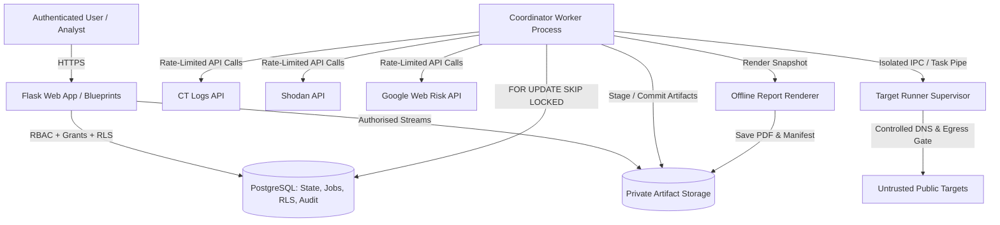

# Requirements

### Overview & Goals
The SaaS Technical Due Diligence Platform provides automated, unauthenticated technical verification of public SaaS infrastructure for internal IT Security teams. It evaluates data storage location indications, observed third-party and hosting dependencies, and visible external security posture. The platform is designed as a secure Flask modular monolith with PostgreSQL durable jobs, isolated target execution, and defensible bilingual (English and Swiss Standard German `de-CH`) PDF report generation with manual TPRM handoff.

### Scope
#### In Scope
- **Domain & Scope Normalisation**: Strict IDNA canonicalisation, public suffix rejection, and boundary enforcement.
- **Discovery**: Certificate Transparency (CT) log discovery with opaque cursor pagination and wildcard retention.
- **Egress & Destination Screening**: Strict anti-SSRF DNS pinning, blocking private/internal/cloud metadata IPv4/IPv6 ranges before connection.
- **Technical Checks**: Live TLS chain/name validation, HTTP security metadata, isolated Playwright screenshot capture, GeoIP/ASN location attribution, Shodan host service/CVE records, and URL reputation lookups.
- **Technical Interpretation**: Versioned rule-based finding generation with explicit separation of severity, confidence, and attribution.
- **Access Control & RLS**: Local team authentication, mandatory MFA, object-level assessment and exact-version report grants, and PostgreSQL Row-Level Security (RLS) defence in depth.
- **Durable Execution**: Transactional PostgreSQL `FOR UPDATE SKIP LOCKED` job queue with lease heartbeat, generation fencing, quota tracking, and graceful cancellation.
- **Evidence & Reporting**: Storage abstraction (private filesystem initial driver), immutable JSON snapshots, offline bilingual (`en`/`de-CH`) PDF rendering, and TPRM manual handoff audit.
- **Retention & Operations**: Configurable 12-calendar-month retention clock, daily purge, backup/restore deletion replay, and operator runbooks.

#### Out of Scope
- Vendor questionnaires, document collection, contractual subprocessor registers, or supplier risk acceptance workflows (managed in TPRM).
- Enterprise OIDC/SSO (deferred to Phase 2).
- Active port scanning, vulnerability exploitation, fuzzing, or authenticated target sessions.
- Distributed brokers (Celery, Redis, Kafka) or microservice decomposition.
- Public customer portal, self-registration, billing, or automated multi-tenancy.

### User Stories
- **As an Assessment Owner**, I want to define a target domain scope and launch a scan so that the platform automatically discovers public hosts, evaluates TLS/HTTP/ports, and gathers screenshots.
- **As an Analyst**, I want to review host inventories, filter by provider/country/severity, and annotate technical findings so that false attributions can be corrected before reporting.
- **As a Reviewer**, I want to inspect frozen report snapshots and approve or request revisions under optional four-eyes governance.
- **As a Report Recipient**, I want to view and download an approved, bilingual report version without accessing raw assessment data or subsequent scans.
- **As an IT Security Operator**, I want to manage provider quotas, monitor job queues, configure retention policies, and execute verified backup/restore drills.

### Functional Requirements
- **FR-01 Scope Management**: Accept single DNS hostnames; canonicalise to ASCII lowercase; enforce dot-label boundaries; reject URL syntax, IP literals, and public suffixes.
- **FR-02 CT Discovery**: Query CT host endpoint; follow `next_cursor`; record wildcards as patterns; enforce run host caps (default 1,000).
- **FR-03 Network Screening**: Resolve DNS via controlled resolvers; reject loopback/private/link-local/metadata IP ranges (IPv4 & IPv6); pin validated IP per connection.
- **FR-04 Endpoint Validation**: Probe HTTPS 443; record certificates, SAN matches, validity, and trust; skip dependent active enrichment on failed TLS with explicit reason.
- **FR-05 Host Enrichment**: Collect GeoIP/ASN, HTTP headers, Shodan IP-level service/CVE data, Web Risk URL reputation, and Playwright screenshots within an isolated sandbox.
- **FR-06 Technical Interpretation**: Evaluate versioned rules; generate findings with severity (`informational` to `critical`), confidence (`low` to `high`), and attribution (`hostname_supported`, `ip_only`, `shared_infrastructure`).
- **FR-07 Workspace UI**: Jinja + HTMX + Tailwind interface; paginated host table, summary cards (Location, Providers, Security), and inline annotation revisions.
- **FR-08 Defensible Reporting**: Create immutable JSON snapshots; render offline `en` and `de-CH` PDFs; verify SHA-256 manifests; record manual TPRM handoff.
- **FR-09 Authorisation & Sharing**: Scoped assessment grants (Owner, Analyst, Reviewer, Viewer) and exact-version report grants enforced in service logic and PostgreSQL RLS.
- **FR-10 Retention & Cleanup**: 12-calendar-month UTC retention clocks; clamp leap days; purge expired records and storage artifacts daily.

### Non-Functional Requirements
- **Security & Isolation**: Runner processes run non-root in isolated sandboxes without database or cloud credentials. No raw collected HTML rendering.
- **Integrity**: Append-only observations and immutable report snapshots with cryptographic manifests.
- **Reliability**: At-least-once job execution with idempotency keys and lease generation fencing to prevent stale writes.
- **Auditability**: Complete audit trails for authentication, grant changes, scan cancellation, report approval/issuance, downloads, and deletion.

# Technical Design

### Current Implementation
The repository currently contains the architectural design baseline in `/docs/`, coding standards in `.aiassistant/rules/`, and an initial minimal Flask skeleton in `app.py`. There are no implemented database models, background workers, or frontend components.

### Key Decisions
- **Architecture**: Modular Flask monolith using the Application Factory pattern and Blueprints. Synchronous background coordinator sharing the codebase.
- **Persistence & Queue**: PostgreSQL for relational entities, JSONB snapshots, and a lightweight `FOR UPDATE SKIP LOCKED` durable job queue (avoiding external broker dependencies like Celery/Redis).
- **Egress & Runner Isolation**: Dedicated isolated runner for target HTTP/TLS/browser interactions with strict DNS validation and egress filtering to prevent SSRF and internal network probing.
- **Storage**: Abstract storage interface (`stage`, `commit`, `open`, `verify`, `delete`) backed by a private filesystem volume for Phase 1, ready for S3/MinIO.
- **Frontend**: Server-rendered Jinja templates enhanced with HTMX for real-time progress polling and Tailwind CSS for styling.
- **Reporting**: Immutable canonical JSON snapshots rendered offline to PDF using Playwright in `en` and `de-CH` (Swiss Standard German).
- **Access Control**: RBAC combined with object-level assessment and report grants, reinforced by PostgreSQL Row-Level Security (RLS).

### Architecture Diagram


### Module Structure
```text
app/
  __init__.py              # Application factory (create_app)
  config.py                # Centralized, validated environment configuration
  extensions.py           # Unbound Flask extensions (SQLAlchemy, Migrate, Security)
  blueprints/
    auth/                  # Authentication, onboarding, MFA routes
    assessments/           # Assessment CRUD, run triggers, host inventory UI
    reports/               # Report preview, approvals, issuance, downloads
    sharing/               # Case and report version grant management
    admin/                 # Quota, provider status, operational settings
  models/                  # SQLAlchemy models, RLS helper definitions, constraints
  service/
    access/                # ActorContext, permission matrix, grant evaluation
    assessment/            # Assessment lifecycle, scope management
    discovery/             # CT log client, pagination, scope normalisation
    checks/                # Provider adapters, pure technical rules, findings
    jobs/                  # Job queue state machine, leases, quota ledger
    evidence/              # Artifact storage interface (filesystem/S3), retention
    reporting/             # Snapshot builder, rendering orchestrator, TPRM handoff
  templates/              # Base layout, Jinja macros, HTMX partials, report templates
  static/                 # Tailwind CSS and frontend assets
  translations/           # Message catalogs (en, de-CH)
  utils/                  # Pure utility helpers (IP parsing, formatting)
runner/                   # Isolated collector & browser sandbox entry points
tests/                    # Pytest unit, integration, RLS, and security fixtures
migrations/               # Alembic database migration scripts
docs/
  implementation/         # Detailed Epics, Stories, and DoDs
  backlog.md              # Project backlog and open decisions tracker
```

### Invariants Enforced
- **INV-01**: A role never grants access to an unrelated assessment.
- **INV-02**: Report-only access never grants underlying case, job, host or raw-artifact access.
- **INV-03**: Every collected fact identifies its subject, source, time and collection method.
- **INV-04**: No data, no match, not licensed and collection failure are distinct outcomes.
- **INV-05**: A CT entry is not live TLS validation; an IP observation is not automatic hostname attribution.
- **INV-06**: All target traffic crosses enforced public-only egress; target execution holds no application credentials.
- **INV-07**: Issued report content and artifact bytes never change; corrections create a new version.
- **INV-08**: Retrying jobs cannot create duplicate logical observations or accept stale worker results.
- **INV-09**: Access expires at the policy deadline even if physical deletion is delayed.
- **INV-10**: DE and EN reports describe identical facts; raw evidence is preserved in its source language.
- **INV-11**: Export/download is not proof of confirmed TPRM transfer.
- **INV-12**: No network work, scheduler or migration starts as an import-time side effect.

# Epics and Stories

### Phased Epic Breakdown

The implementation plan is structured into 8 core Epics (Milestones M0 through M7) documented in `/docs/implementation/` and tracked in `/docs/backlog.md`.

---

### Epic 0: Project Foundation & Test Harness (`docs/implementation/epic-00-foundation.md`)
- **Story 0.1: Application Factory & Centralised Configuration**
  - Implement `create_app()` factory, configuration classes (`DevelopmentConfig`, `TestingConfig`, `ProductionConfig`), and strict startup validation in `app/config.py`.
  - *DoD*: Factory instantiates independently without import side-effects; startup fails if required keys are missing; passing tests.
- **Story 0.2: Extension Wiring & Database Fixtures**
  - Initialize SQLAlchemy, Alembic, and Flask-WTF in `app/extensions.py`; configure PostgreSQL test container / fixture harness in `tests/conftest.py`.
  - *DoD*: Database migrations run cleanly from clean state; rollback tests pass; no runtime credentials checked into repository.
- **Story 0.3: Tooling, Linting & Type Checking**
  - Configure `pyproject.toml`, Ruff linting/formatting, and Mypy strict type checking.
  - *DoD*: CI passes formatting, linting, and type verification.

---

### Epic 1: Identity, Grants & Database RLS (`docs/implementation/epic-01-access-control.md`)
- **Story 1.1: Local Authentication & MFA Setup**
  - Integrate Flask-Security-Too for invitation-only team accounts, password hashing, and TOTP MFA in `app/blueprints/auth/`.
  - *DoD*: Public registration disabled; admin CLI bootstrap functional; MFA enforced before access; brute-force rate-limiting active.
- **Story 1.2: Workspace & Assessment Object Grants**
  - Implement `ActorContext`, permission evaluation service in `app/service/access/`, and models for `AssessmentGrant` and `ReportGrant`.
  - *DoD*: Two-case access matrix verified (ACC-01); privilege escalation and foreign-scope access denied.
- **Story 1.3: PostgreSQL Row-Level Security Policies**
  - Write and apply SQL RLS policies on `assessment`, `host`, `check_result`, and `artifact` tables in Alembic migrations.
  - *DoD*: Pooled connection isolation verified (ACC-02); non-owner runtime DB role cannot bypass tenant constraints.

---

### Epic 2: Durable Job Queue & Quota Accounting (`docs/implementation/epic-02-durable-jobs.md`)
- **Story 2.1: Transactional Queue State Machine**
  - Implement `Job` and `JobAttempt` models, `FOR UPDATE SKIP LOCKED` claim logic, and heartbeat renewal in `app/service/jobs/`.
  - *DoD*: Multi-worker concurrency verified; worker crash and lease reclamation verified (JOB-01, JOB-02); stale worker completion rejected.
- **Story 2.2: Quota Ledger & Rate Limiting**
  - Build `QuotaReservation` and `ProviderUsage` accounting to track CT and Shodan credits before dispatching calls.
  - *DoD*: Quota exhaustion transitions run to `waiting_provider` without blocking web threads; crash reconciliation verified.
- **Story 2.3: Scan Run Lifecycle & Cancellation**
  - Implement scan state transitions (`queued`, `running`, `complete`, `partial`, `cancelled`) and graceful worker termination.
  - *DoD*: Finalisation race test verified (JOB-03); partial results retained upon cancellation.

---

### Epic 3: Scope Normalisation & Discovery Network Gate (`docs/implementation/epic-03-discovery-network-gate.md`)
- **Story 3.1: Scope Normaliser & Public Suffix Screening**
  - Implement domain sanitiser, IDNA ASCII canonicaliser, and PSL boundary validator in `app/service/discovery/scope.py`.
  - *DoD*: Wildcard, URL, IP literal, and public suffix inputs rejected; dot-label boundary tests pass.
- **Story 3.2: CT Log Discovery Adapter**
  - Implement CT client in `app/service/discovery/ct.py` with cursor pagination, deduplication, and wildcard pattern retention.
  - *DoD*: Discovery paging fixtures pass (COL-01); wildcard names stored as patterns, not concrete hosts; rate limits respected.
- **Story 3.3: DNS Resolver & SSRF Egress Gate**
  - Build strict DNS resolver in `runner/` rejecting private IPv4/IPv6, loopback, link-local, and cloud metadata addresses (169.254.169.254).
  - *DoD*: Egress gate blocks rebinding, redirects to private IPs, and mixed answers at network boundary (NET-01, NET-02).

---

### Epic 4: Host Verification & Enrichment Adapters (`docs/implementation/epic-04-enrichment-adapters.md`)
- **Story 4.1: Live TLS Endpoint Prober**
  - Implement TLS connection verifier capturing certificate chain, SNI match, validity dates, and cipher info.
  - *DoD*: Failed/expired/mismatched TLS recorded explicitly without disabling validation; dependent checks skipped (COL-02).
- **Story 4.2: Isolated Screenshot Sandbox Supervisor**
  - Build Playwright Chromium screenshot capture with viewport ceilings, network egress filtering, and disposable profile.
  - *DoD*: Screenshots captured safely; non-HTML endpoints marked `not_applicable`; memory and timeout ceilings enforced.
- **Story 4.3: GeoIP, Shodan & Reputation Adapters**
  - Implement MaxMind/IP2Location local dataset reader, Shodan IP-level service/CVE queries, and Google Web Risk URL reputation lookup.
  - *DoD*: Missing entitlement, timeout, 404, and clean results clearly differentiated (PRV-01); shared IP attribution separated from hostname findings (FIND-01).

---

### Epic 5: Technical Workspace & Annotation UI (`docs/implementation/epic-05-workspace-ui.md`)
- **Story 5.1: Assessment Overview & Summary Cards**
  - Build Jinja/HTMX templates for the Overview screen with Location, Providers, and Security technical summary cards.
  - *DoD*: Summary cards reflect structured facts with explicit limitations; real-time HTMX scan progress updates without page reload.
- **Story 5.2: Searchable Host Inventory Table**
  - Implement paginated, filterable host table with sorting by country, provider, TLS status, and finding severity.
  - *DoD*: Keyset/bounded pagination with 1,000-host fixtures performs under 200ms; keyboard navigable (UX-01, PERF-01).
- **Story 5.3: Finding Revision & Annotation Engine**
  - Implement optimistic-locking annotation forms allowing analysts to flag false positives or provide context.
  - *DoD*: Original observations preserved append-only; revision conflicts return HTTP 409; audit trail recorded.

---

### Epic 6: Evidence Storage & Bilingual Reporting (`docs/implementation/epic-06-evidence-reporting.md`)
- **Story 6.1: Storage Driver & Staging Lifecycle**
  - Implement `StorageDriver` with private filesystem backend, staging directory, atomic rename, SHA-256 verification, and path traversal protection.
  - *DoD*: Staging failures and orphan files handled cleanly (EVD-01); files stored outside web root with restricted permissions.
- **Story 6.2: Canonical Report Snapshot Builder**
  - Implement snapshot freeze serialising run facts, coverage counts, findings, and evidence references into deterministic UTF-8 JSON.
  - *DoD*: Snapshot hash is immutable (REP-01); rerun does not alter issued snapshot; four-eyes approval bound to content hash.
- **Story 6.3: Bilingual PDF Renderer & Manifest Generator**
  - Implement offline Playwright PDF renderer with Swiss Standard German (`de-CH`) and English catalogs, generating cryptographic SHA-256 manifests.
  - *DoD*: DE/EN reports contain identical technical facts (LNG-01); report recipient isolation verified (REP-02); failed rendering halts publication.
- **Story 6.4: Manual TPRM Handoff Logger**
  - Implement manual transfer confirmation logging (actor, timestamp, external TPRM reference) in `app/service/reporting/`.
  - *DoD*: Download does not auto-confirm transfer (INV-11); unconfirmed transfer warnings displayed.

---

### Epic 7: Data Retention & Operational Hardening (`docs/implementation/epic-07-lifecycle-operations.md`)
- **Story 7.1: Calendar-Month Retention Clocks & Daily Purge**
  - Implement 12-calendar-month UTC expiry calculators with leap-day clamping and daily batch deletion jobs in `app/service/evidence/retention.py`.
  - *DoD*: Expired records immediately denied read access (RET-01); physical deletion removes DB rows and storage files idempotently.
- **Story 7.2: Administrative Holds & Backup/Restore Deletion Replay**
  - Implement scoped retention holds and a restoration replay mechanism to re-purge records deleted prior to backup restoration.
  - *DoD*: Holds prevent purge; backup restore drill successfully replays deletion journal (OPS-01).
- **Story 7.3: Operator Runbook & Production Hardening**
  - Author complete operator runbooks for bootstrapping, secret rotation, quota recovery, and disaster recovery.
  - *DoD*: Runbooks verified against local Docker Compose environment.

# Testing

### Validation Approach
Verification follows a layered testing strategy ensuring security boundaries, invariants, and data integrity are rigorously tested before code is accepted.

### Acceptance Test Matrix
| Test ID | Area | Scenario & Expected Behavior |
|---|---|---|
| **ACC-01** | Authorization | Verify 2-case, 2-user matrix with Owner, Analyst, Reviewer, Viewer, and Report-Only roles; unauthorized access returns 404/403. |
| **ACC-02** | RLS / Pooled DB | Verify PostgreSQL RLS prevents data leakage across pooled connections when user context switches without connection reset. |
| **COL-01** | Discovery | Verify CT log parser handles cursor pagination, duplicate hostnames, empty results, and wildcards without creating concrete hosts. |
| **COL-02** | TLS Check | Verify expired, untrusted, or mismatched TLS certificates are recorded with failure reasons and skip active HTTP collection. |
| **NET-01** | SSRF Gate | Verify DNS resolution and HTTP/browser requests to private IPv4/IPv6, link-local, loopback, and cloud metadata (169.254.169.254) are rejected. |
| **NET-02** | Sandbox Egress | Verify Playwright browser sandboxes cannot access internal application networks or bypass egress proxies via WebSockets/WebRTC. |
| **JOB-01** | Job Recovery | Simulate worker crash before call, during call, and before commit; verify lease recovery and at-most-one accepted logical result. |
| **JOB-02** | Concurrency | Verify stale lease workers cannot commit results after lease expiration and reassignment to another worker. |
| **JOB-03** | Finalization Race | Verify run finalization does not mark a scan complete while child jobs are being inserted by concurrent worker completions. |
| **PRV-01** | Provider Errors | Verify 401, 403, 404, 429, timeout, and malformed responses from Shodan/WebRisk are distinctly classified without false `no_match`. |
| **FIND-01** | Attribution | Verify Shodan CVEs on shared IPs/CDNs are marked `shared_infrastructure` / `ip_only` rather than falsely attributed to the hostname. |
| **EVD-01** | Artifact Storage | Verify storage driver rejects directory traversal, handles staging failures, and verifies SHA-256 hashes on commit and read. |
| **REP-01** | Report Immutability | Verify modifying an assessment or re-running scans does not alter previously issued report snapshots or rendered PDFs. |
| **REP-02** | Report Isolation | Verify report-only recipients can only access their specific report version and approved evidence, not raw scan artifacts. |
| **LNG-01** | Bilingual Parity | Verify `en` and `de-CH` reports generated from the same snapshot contain identical finding IDs, severity counts, and facts. |
| **RET-01** | Retention Clocks | Verify 12-calendar-month retention expiry with leap-day clamping (Feb 29 -> Feb 28); verify expired records are unreadable before purge. |
| **OPS-01** | Disaster Recovery | Execute backup restore drill and verify deletion journal replays successfully to purge expired records restored from backup. |
| **UX-01** | Accessibility | Verify full assessment creation, host filtering, and report export workflow using keyboard navigation only. |
| **PERF-01** | Performance | Benchmark 1,000-host scan; verify host table pagination renders within 200ms and memory remains bounded. |

### Test Harness & Strategy
- **Unit & Service Tests**: Pytest with isolated synthetic provider fixtures (no live internet access in default test suite).
- **Database & RLS Tests**: Real disposable PostgreSQL instance running full migrations and non-superuser roles to validate RLS policies.
- **Browser & Render QA**: Playwright test suite for UI flows and visual verification of rendered PDF reports.
- **Network Adversarial Tests**: Mock DNS server providing rebinding and private IP answers to validate SSRF boundary enforcement.

# Delivery Steps

### ✓ Step 1: Setup Implementation Documentation & Backlog Tracker
The `/docs/backlog.md` tracker and `/docs/implementation/` directory structure and templates are established.

- Create `docs/backlog.md` capturing all open architectural decisions (OPEN-01 through OPEN-06), deferred Phase 2 items, and risk registers.
- Create the `docs/implementation/` directory structure with `README.md` outlining the Epic/Story decomposition methodology and shared Definition of Done (DoD) framework.
- Define standard Story templates including Goal, Invariants Enforced, Technical Contracts, Acceptance Criteria, and DoD checklist.

### ✓ Step 2: Document M0-M2 Epics: Foundation, Security & Job Engine
Detailed specifications for Milestones M0, M1, and M2 are fully documented with actionable Epics, Stories, and DoDs in `/docs/implementation/`.

- Author `docs/implementation/epic-00-foundation.md` covering Flask factory, configuration validation, dependency locking, and PostgreSQL test harness.
- Author `docs/implementation/epic-01-access-control.md` covering local authentication, MFA, workspace and assessment object grants, session security, and PostgreSQL RLS policies.
- Author `docs/implementation/epic-02-durable-jobs.md` covering PostgreSQL `SKIP LOCKED` job queue, lease generation fencing, quota reservation ledger, cancellation, and progress polling.

### ✓ Step 3: Document M3-M4 Epics: Discovery, Egress Gate & Enrichment
Detailed specifications for Milestones M3 and M4 are fully documented with actionable Epics, Stories, and DoDs in `/docs/implementation/`.

- Author `docs/implementation/epic-03-discovery-network-gate.md` covering domain scope normalisation, CT log paging adapter, DNS resolution, and strict SSRF egress filtering and destination pinning.
- Author `docs/implementation/epic-04-enrichment-adapters.md` covering GeoIP/ASN lookup, live TLS verification, Playwright screenshot sandbox supervisor, Shodan IP-level queries, and Web Risk reputation checks.

### ✓ Step 4: Document M5-M7 Epics: UI, Bilingual Reports & Operations
Detailed specifications for Milestones M5, M6, and M7 are fully documented with actionable Epics, Stories, and DoDs in `/docs/implementation/`.

- Author `docs/implementation/epic-05-workspace-ui.md` covering Jinja/HTMX/Tailwind host inventory, filtering, detail views, summary cards, and analyst finding annotations.
- Author `docs/implementation/epic-06-evidence-reporting.md` covering private filesystem storage driver, frozen canonical JSON snapshots, bilingual (`en` and `de-CH`) PDF rendering via Playwright, and manual TPRM handoff logging.
- Author `docs/implementation/epic-07-lifecycle-operations.md` covering 12-month calendar retention clocks, hold management, idempotent purge jobs, backup/restore deletion replay, and operator runbooks.

### ✓ Step 5: Consolidate Traceability Matrix & Execution Baseline
The complete phased implementation plan is consolidated with full traceability against acceptance tests, cross-cutting invariants, and delivery gates.

- Create `docs/implementation/traceability-matrix.md` mapping all acceptance tests (ACC-01 through PERF-01) and cross-cutting invariants (INV-01 through INV-12) to specific stories.
- Verify consistency across all milestone files and update `docs/backlog.md` with resolved vs. tracking items.
- Present the final implementation package ready for development kickoff.

### ✓ Step 6: Story 0.3 Tooling, Dependencies & Quality Baseline
Setup `pyproject.toml`, lock runtime & dev dependencies, configure Ruff and strict Mypy.

### ✓ Step 7: Story 0.1 Application Factory & Centralised Configuration
Implement `app/config.py` (BaseConfig, Dev, Test, Prod + validate_config) and `app/__init__.py` (create_app factory) with unit tests.

### ✓ Step 8: Story 0.2 Extension Wiring & Database Fixtures
Initialize SQLAlchemy, Migrate, CSRF, Security in `app/extensions.py`, setup Alembic migrations and `tests/conftest.py` test harness with migration tests.

### ✓ Step 9: Story 1.1 Local Authentication & MFA Setup
Implement User, Role, Workspace, Membership models, Flask-Security-Too SQLAlchemy datastore, auth blueprint, TOTP MFA enforcement, admin bootstrap CLI command, and auth unit tests.

### ✓ Step 10: Story 1.2 Workspace & Assessment Object Grants
Implement ActorContext, AssessmentGrant, ReportGrant, permission evaluation service, and ACC-01 test matrix covering 2 cases and 5 user roles.

### ✓ Step 11: Story 1.3 PostgreSQL Row-Level Security Policies
Implement PostgreSQL RLS policies in Alembic migrations, session context manager for SET LOCAL app.user_id / app.workspace_id, and ACC-02 pooled connection isolation tests.

### ✓ Step 12: Story 2.1 Transactional Queue State Machine
Implement `Job` and `JobAttempt` models, PostgreSQL `FOR UPDATE SKIP LOCKED` claim logic, heartbeat renewal, generation fencing (`generation_id`), and JOB-01 / JOB-02 concurrency and crash recovery tests.

### ✓ Step 13: Story 2.2 Quota Ledger & Rate Limiting
Implement `ProviderQuota` and `QuotaReservation` models and ledger service (`reserve_quota`, `commit_quota`, `release_quota`), quota exhaustion handling (`waiting_provider`), and tests in `tests/jobs/test_quota.py`.

### ✓ Step 14: Story 2.3 Scan Run Lifecycle & Cancellation
Implement `ScanRun` model, scan run state progression, dynamic child job tracking, cancellation with graceful worker handling, and JOB-03 finalisation race condition tests in `tests/jobs/test_run_lifecycle.py`.

### ✓ Step 15: Story 3.1 Scope Normaliser & Public Suffix Screening
Implement domain scope canonicalisation, IDNA translation, Public Suffix List (PSL) screening, dot-label boundary validator, and unit tests in `app/service/discovery/scope.py` and `tests/discovery/test_scope.py`.

### ✓ Step 16: Story 3.2 CT Log Discovery Adapter
Implement CT client in `app/service/discovery/ct.py` with cursor pagination, deduplication, wildcard pattern retention, host caps, and COL-01 tests.

### ✓ Step 17: Story 3.3 DNS Resolver & SSRF Egress Gate
Build strict DNS resolver in `runner/dns.py` and destination-pinned HTTP egress gate in `runner/egress.py` rejecting private/loopback/cloud metadata IPs and mixed answer sets (NET-01, NET-02).

### ✓ Step 18: Story 4.1 Live TLS Endpoint Prober
Implement TLS endpoint probe in `runner/tls.py` and TLS check service in `app/service/checks/tls.py`, capturing trust chains, SAN coverage, validity dates, cipher suites, explicit failure reasons, and skipping dependent active checks on TLS failure (COL-02).

### ✓ Step 19: Story 4.2 Isolated Screenshot Sandbox Supervisor
Build Playwright Chromium screenshot capture in `runner/browser.py` with viewport ceilings, network egress filtering, disposable profile, non-HTML detection, and sandboxing (NET-02).

### ✓ Step 20: Story 4.3 GeoIP, Shodan & Reputation Adapters
Implement GeoIP dataset reader (`app/service/checks/geoip.py`), Shodan host lookup with attribution tagging (`app/service/checks/shodan.py`), and Google Web Risk lookup (`app/service/checks/webrisk.py`) with explicit outcome classifications (PRV-01, FIND-01).

### * Step 21: Story 5.1 Assessment Overview & Summary Cards
Build Jinja/HTMX templates for the Overview screen with Location, Providers, and Security technical summary cards.

###   Step 22: Story 5.2 Searchable Host Inventory Table
Implement paginated, filterable host table with sorting by country, provider, TLS status, and finding severity.

###   Step 23: Story 5.3 Finding Revision & Annotation Engine
Implement optimistic-locking annotation forms allowing analysts to flag false positives or provide context.

###   Step 24: Story 6.1 Storage Driver & Staging Lifecycle
Implement `StorageDriver` with private filesystem backend, staging directory, atomic rename, SHA-256 verification, and path traversal protection (EVD-01).

###   Step 25: Story 6.2 Canonical Report Snapshot Builder
Implement snapshot freeze serialising run facts, coverage counts, findings, and evidence references into deterministic UTF-8 JSON (REP-01).

###   Step 26: Story 6.3 Bilingual PDF Renderer & Manifest Generator
Implement offline Playwright PDF renderer with Swiss Standard German (`de-CH`) and English catalogs, generating cryptographic SHA-256 manifests (LNG-01, REP-02).

###   Step 27: Story 6.4 Manual TPRM Handoff Logger
Implement manual transfer confirmation logging (actor, timestamp, external TPRM reference) in `app/service/reporting/` (INV-11).

###   Step 28: Story 7.1 Calendar-Month Retention Clocks & Daily Purge
Implement 12-calendar-month UTC expiry calculators with leap-day clamping and daily batch deletion jobs in `app/service/evidence/retention.py` (RET-01).

###   Step 29: Story 7.2 Administrative Holds & Backup/Restore Deletion Replay
Implement scoped retention holds and a restoration replay mechanism to re-purge records deleted prior to backup restoration (OPS-01).

###   Step 30: Story 7.3 Operator Runbook & Production Hardening
Author complete operator runbooks for bootstrapping, secret rotation, quota recovery, and disaster recovery (OPS-01).