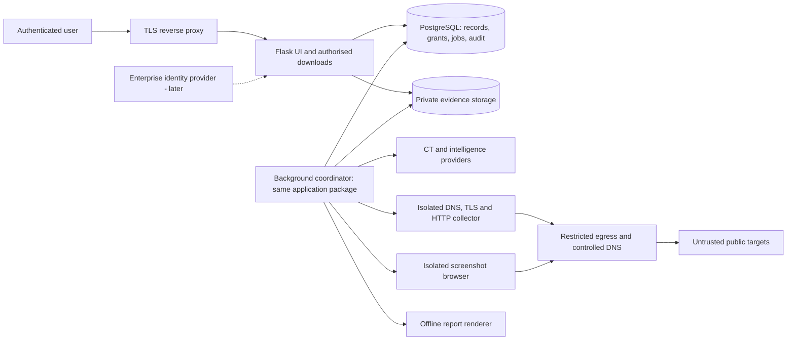

# SaaS technical due diligence platform

Status: architecture design baseline for coding agents; confirmed product decisions and proposed implementation defaults are distinguished below. Documentation only; no application has been implemented.
Prepared: 2026-10-01. Provider documentation checked on that date.

Start with [the coding-agent index](README.md). Detailed contracts: [application and coding boundaries](design/application.md), [data model](design/data-model.md), [access control](design/access-control.md), [collection and jobs](design/collection.md), [evidence and reports](design/evidence-reporting.md), and [implementation/acceptance plan](design/implementation-plan.md). Those documents refine this overview into implementation contracts without changing the confirmed product scope.

## 1. Recommendation and assumptions

Build a Flask modular monolith with background workers, PostgreSQL, and private evidence storage behind a replaceable storage interface. Use Jinja, HTMX and Tailwind for the interface. Keep discovery, observations, analyst conclusions and issued reports separate. An assessment is private until its owner grants access.

Phase 1 is limited to the owner and their internal team, with segregated assessments and authenticated sharing. Customer accounts, self-service, billing and public APIs are outside this phase. Model a workspace boundary without building a multi-tenant commercial service. Assume modest volumes: tens of simultaneous assessments, with configurable host limits; this is a planning assumption, not a tested capacity claim.

User decisions: defer enterprise SSO; make retention configurable with a 12-month default; do not require Swiss-hosted managed object storage. Hosting remains deployment-configurable. For the small team deployment, propose a private filesystem volume initially, with optional S3/MinIO support through the storage interface. This storage choice is a design recommendation, not a claim that the user selected a specific backend. Outbound intelligence providers still receive lookup data.

Phase 2 may publish the source code. Open sourcing does not introduce customer login or public hosting requirements. Keep deployment configuration and licensed provider data outside the source distribution; defer the open-source licence decision until release planning.

This is a pure technical verification platform for public SaaS infrastructure. It cannot certify a SaaS provider's internal security, enumerate every host, or prove data residency from public infrastructure. Do not build questionnaires, vendor-document collection, contractual processor registers or supplier-response workflows. Analysts may annotate technical findings and correct attribution; wider supplier assurance and final business decisions belong in the leading TPRM tool.

IT Security owns operation of this non-critical system. Due diligences are not time critical and can be performed manually during an outage. Final reports are stored in the leading TPRM tool, which is the system of record; this platform retains working results and report copies under its configurable retention policy. Reports must be available in English and German (Swiss Standard German). A translated DE/EN interface is a desirable enhancement, with translation-ready application texts from the outset.

Current repository: project rules and architecture documentation; no existing application, schema, authentication implementation or tests to preserve. The proposal follows the supplied Flask conventions.

### Alternatives considered

| Approach | Fit and advantages | Trade-offs and security/operations impact |
|---|---|---|
| **A. Native Flask services with selected provider adapters — recommended** | Focused workflow, consistent permissions and evidence lineage, one application codebase | Requires building collectors and a small durable job mechanism; sandboxing and provider contracts must be engineered explicitly |
| B. Flask workflow with a pinned Web Check deployment as a collection backend | Useful when a broad set of existing checks is needed quickly | Adds another runtime and update surface; outputs still need normalisation, isolation, access control and evidence handling; evaluate individual checks before enabling them |

Web Check is a useful feature reference and is MIT licensed; reuse requires preserving the applicable notice. Its code licence does not grant rights to redistribute upstream provider data. This proposal does not assume its isolation or multi-user evidence handling has been audited. [Repository](https://github.com/lissy93/web-check), [licence](https://github.com/lissy93/web-check/blob/master/LICENSE).

## 2. Technical answers to the due diligence questions

| Question | Automated evidence | Technical conclusion boundary | Presentation |
|---|---|---|---|
| Where is data stored? | DNS/IP relationships, estimated network location, ASN, CDN/cloud indicators | Public endpoint location can be estimated; database, backup and internal processing regions cannot be established by these checks | **Observed infrastructure location** with country/source/confidence; mark actual storage location as not technically verified |
| Who processes the data? | CNAME/MX relationships, network organisations, observed third-party browser requests | Identify observed providers and possible data recipients; these checks do not establish legal processors, purpose or the complete processing chain | **Observed providers and third parties**, grouped by hosting/CDN/DNS/mail/browser dependency, with supporting observations |
| Are the systems secure? | TLS/HTTP observations, threat-list matches, Shodan ports and CVE observations | Verify specific externally visible controls and exposures at the recorded time; internal security remains outside coverage | **Observed security posture** with findings, attribution, confidence, freshness and check coverage |

An ASN owner is not automatically a processor; a CDN edge country is not the database location. Third-party scripts indicate a possible data recipient, not the full contractual processing relationship. Absence of a threat match or CVE is not proof of safety.

Generate each technical summary from versioned check rules and collected evidence, showing source references, observation time, confidence and coverage limitations. There are no mandatory answer fields or questionnaire completion states. Technical status such as `observed`, `inferred`, `not_observable` or `conflicting` is separate from execution status and severity. Optional analyst annotations preserve author/time and the original observations. Supplier acceptance and risk acceptance are handled in TPRM.

## 3. Components and trust boundaries

| Component | Responsibility and boundary |
|---|---|
| Flask application factory and Blueprints | Sessions, validated forms, permission checks, navigation and HTMX partials; no scans within HTTP request lifetimes |
| Service layer | Assessment lifecycle, discovery orchestration, provider adapters, evidence references, interpretation, grants and report issue workflow |
| PostgreSQL | Authoritative structured state, tenant/case permissions, append-only observations, job leases, quota reservations and audit metadata |
| Coordinator workers | Claim jobs; call fixed provider endpoints; validate collector outputs; persist results; enforce budgets and retries |
| Network collector and screenshot sandbox | Process only bounded job inputs; inspect public destinations through enforced egress policy; no DB, bucket, IdP or provider credentials |
| Evidence storage | Screenshots, permitted provider payloads, report PDFs and manifests; private and encrypted |
| Report renderer | Render frozen, escaped application templates and staged evidence offline; no arbitrary URL loading, no target browser sessions |

The coordinator receives sandbox output through a bounded result channel and performs storage writes. Do not mount the Docker socket into the web app or target browser. Production target execution belongs on a dedicated isolated runner host or equivalent stronger sandbox; separate containers in one Compose network alone do not establish this boundary.

## 4. Discovery and assessment pipeline

1. **Create assessment.** Enter domain, supplier name, purpose, owner and scope. Canonicalise DNS names with IDNA, preserve display form, reject URLs, credentials, IP literals and public suffixes. Default scope is the entered name and its label-boundary descendants; do not silently widen `app.example.com` to `example.com`. Record permitted collection profile and requestor.
2. **Discover.** Use the CT hostname endpoint and persist pagination checkpoints. Deduplicate names; retain wildcard entries as patterns, never as concrete hosts. An apex can be explicitly probed and labelled `user_supplied` even if absent from CT. SANs outside scope stay excluded. There is no DNS brute forcing in the initial version.
3. **Resolve and screen.** Resolve A, AAAA and CNAME chains independently through controlled DNS. Record every answer, TTL, collection time and vantage point. Block prohibited destinations before any connection. CT-provided DNS is a hint, not a security decision.
4. **Validate live TLS.** Probe in-scope public HTTPS endpoints on 443 using the hostname for SNI and verification. Record the actual connected IP, certificate chain/fingerprint, SAN match, trust result and validity interval. A current CT certificate alone does not establish a valid live service. Revocation status is a separate `good/revoked/unknown/not_checked` observation; do not imply it was checked by ordinary TLS validation.
5. **Enrich eligible endpoints.** A reachable endpoint with a trusted, in-date, hostname-matching certificate qualifies for the full HTTPS profile: HTTP metadata, screenshot, reputation checks, network location/provider attribution and Shodan enrichment. Track eligibility per endpoint/IP; one success does not validate all addresses. Non-HTML services still receive enrichment with screenshot marked `not_applicable`.
6. **Retain failures.** Invalid TLS, DNS failures, unreachable endpoints and wildcard-only evidence remain visible. Report their reason and coverage impact; never drop them from the inventory or disable certificate validation to obtain a screenshot. Passive enrichment may still run for failed hosts, clearly labelled.
7. **Interpret.** Produce evidence-backed technical findings and summaries automatically. Analysts may validate attribution, flag false positives and add technical notes; no questionnaire, vendor upload or supplier response is required. Save annotations as revisions, preserving original observations.
8. **Issue and export report.** Freeze one selected terminal run, technical summaries, findings, annotations and evidence into a report version in DE and/or EN. Export final reports for manual storage in TPRM. Later scans create new observations and reports, never change issued evidence. Multi-run comparison is deferred.

CT coverage excludes names hidden by wildcard certificates, unlogged/private certificates, unknown names and provider gaps. Display discovered-name counts, exclusions, pagination completeness and budget limits. Completion means completion of the declared collection scope, not discovery of all subdomains.

### CT plans

| Capability | Free key | Standard |
|---|---|---|
| Monthly credits | 10,000 | 50,000 per package |
| Request limits | 100/hour; one in flight | No listed hourly/serial cap; use bounded concurrency |
| History | Current certificates and certificates expired within 90 days | Same |
| Deep archive | Not included | Not included |

Use `GET /v1/hosts/{domain}`, up to 100 rows per page, following opaque `next_cursor` values. Each page costs one credit. Use `/v1/usage` for keyed balances and Bearer headers for credentials. Reconcile response quota headers; honour `Retry-After`, checkpoint on exhaustion, and expose partial coverage. [CT API documentation](https://api.ctlogs.dev/).

Free/anonymous access is non-commercial. Standard suits internal business assessments and client reports; a customer-facing results portal requires Pro or a separate agreement. Bulk redistribution is separately restricted. Keep provider export permissions distinct from user access permissions. The reviewed public account page did not expose a monetary price; obtain current quotes rather than assume pricing. [Terms](https://ctlogs.dev/terms), [account page](https://account.ctlogs.dev/).

The adapter supports both requested plans, but Free is only a non-commercial evaluation mode. Do not switch to anonymous access or additional keys to bypass exhausted quota. Implement a shared limiter per credential across all workers. Limits are configurable and provider-reconciled, not hardcoded throughout the application.

## 5. Host checks and interpretation

| Requested result | Collection design | Limits and evidence |
|---|---|---|
| Server location | Local licensed IP-country/ASN database; Shodan metadata as additional evidence | Store database version, country estimate, source, IP and timestamp; flag CDN/anycast/shared hosting; no precise map pin by default |
| Server information | Live TLS, bounded HTTP response headers, title and explicit technology hints; Shodan service banners | Headers can be absent or misleading. Preserve observations and confidence; do not turn a banner into a confirmed software inventory |
| Screenshot | Playwright/Chromium in a disposable sandbox, fixed viewport, bounded load time and fresh browser state | Capture URL, timestamp, browser version, viewport and blocked/failed resources. APIs, blocked pages and TLS failures receive an explicit status |
| Malware/phishing | Commercial reputation adapter; Google Web Risk Lookup is the first candidate | Check the scoped URL and allowed redirect URLs. Preserve threat category, query scope and time. `no_match` is not `clean`; timeout, unavailable and not licensed are separate states |
| Vulnerabilities | Shodan records per distinct resolved public IP, then service-level attribution | Preserve CVE, port/transport, source observation time and provider verification flag; distinguish IP association from hostname attribution |
| Open ports | Shodan's observed services, plus the directly observed HTTPS connection | Show `observed open at time T`, not a complete current port scan. Preserve TCP/UDP and source; no result does not mean closed |

Shodan's host endpoint supplies IP-level service observations. Deduplicate queries within an assessment run while retaining links to each resolved hostname. Plan entitlement and allowed archival/report use must be checked before implementation; a missing entitlement is not a successful empty result. [Shodan API](https://developer.shodan.io/api).

Shodan distinguishes verified findings from metadata-inferred findings, which can be false positives. Retain that distinction; even a provider-verified finding does not establish that a shared IP's affected service belongs to this SaaS hostname today. Only promote into supplier findings with suitable hostname/service evidence or explicit analyst review. [Shodan vulnerability assessment](https://help.shodan.io/mastery/vulnerability-assessment).

Safe Browsing's free API is restricted to non-commercial use. Web Risk Lookup provides malware/social-engineering list checks and response expiry metadata. Its documentation also places restrictions on redistribution: contractually establish historical retention and client-report rights, or select a provider that grants them, before claiming reportable evidence. Keep live cache expiry separate from permitted archival retention. [Safe Browsing restrictions](https://developers.google.com/safe-browsing/v4/usage-limits), [Web Risk overview](https://docs.cloud.google.com/web-risk/docs/overview), [Lookup API](https://docs.cloud.google.com/web-risk/docs/lookup-api).

Confirmed Phase 1 scope is public, unauthenticated observation. It does not include login attempts, exploit probes, broad port scans or Shodan scan submissions. DNS, TLS, HTTP and screenshots do contact targets; describe them as low-impact active collection, not wholly passive OSINT. Shodan supplies previously observed ports and vulnerabilities. Active port scanning and authenticated target checks remain deferred.

## 6. User experience

Navigation: **Assessments → Overview / Infrastructure / Providers / Security / Evidence / Reports / Sharing**.

The landing page shows only accessible assessments, with supplier, owner, last run, collection status and important technical findings. New assessment asks for the domain first, then shows the collection scope/profile and estimated quota impact. Start returns immediately; HTMX polling shows discoveries, completed checks, waiting quotas and failures. Cancellation preserves results already collected.

Overview begins with three plain-language technical summary cards corresponding to infrastructure location, observed providers and security posture. Each shows the automated conclusion, evidence strength and what cannot be determined technically. Below are priority findings and coverage: for example, `148 names discovered; 112 eligible HTTPS hosts; 8 unreachable; 6 invalid TLS; 22 excluded/pending`. Counts are illustrative, not actual results. There is no questionnaire progress indicator or supplier-response workflow.

Infrastructure is a searchable, paginated host table: hostname, live TLS, IP/country/provider, screenshot thumbnail, reputation, highest finding severity and last checked. Filters include country, provider, suspected CDN, severity, failed checks and unknowns. Country/provider summaries are clickable filters. Host detail provides evidence tabs and timelines; raw evidence is secondary to readable observations.

Providers groups technically observed hosting, CDN, DNS, mail and browser dependencies. Show the hostname/IP/CNAME/request evidence behind each attribution, timestamps and confidence. Analysts can correct a technical attribution without turning the view into a contractual subprocessor register.

Security separates directly observed issues, provider-reported vulnerabilities and checks with insufficient evidence. Severity and confidence are independent. Use a small versioned technical rule set: finding ID, trigger, severity rationale, attribution criteria, evidence references and limitations. No automatic supplier risk acceptance or unexplained aggregate security score. Optional review concerns technical correctness; overall supplier decisions stay in TPRM.

Reports show frozen versions, language, preparation/review status, recipients and optional manually recorded TPRM reference. Sharing clearly distinguishes an entire assessment from one issued report. Keyboard navigation, labelled controls, text plus colour status and accessible tables are baseline requirements.

### Language support

DE and EN reports are Phase 1 requirements; use Swiss Standard German (`de-CH`, including `ss` instead of `ß`) and English. A report-language selector is independent of the user's UI preference. Both language variants use the same frozen technical snapshot and finding IDs; store each rendered variant with its own hash and template/translation version. Translation changes cannot silently alter an issued artifact.

Design all application-owned text for translation from the outset, including validation, authentication screens, status labels, findings and report captions. Keep stored status/rule identifiers language-neutral and translate at presentation using message catalogs, pluralisation and locale-aware dates/numbers. Full DE/EN UI translations are a desirable enhancement, not a condition for collecting evidence or issuing the required bilingual report variants. Raw provider text, banners, screenshots and analyst notes stay in their original language; any translated explanatory text must be labelled and must not replace original evidence. Do not send evidence to external translation services by default.

## 7. Authentication and authorisation

**Yes: use RBAC for actions plus object-level grants for segregation. RBAC alone is insufficient.**

Phase 1 uses Flask-Security-Too with invitation-only local team accounts, password login, MFA and secure recovery. No public signup or external customer invitations. Use a modern adaptive password hash, login/reset rate limits, one-time expiring recovery tokens and session revocation on password reset or deactivation. Bootstrap the first administrator through a controlled deployment command, never a default password. Authentication and object authorisation remain separate checks. [Flask-Security patterns](https://flask-security-too.readthedocs.io/en/stable/patterns.html).

Enterprise OIDC/SSO is deferred. Keep stable internal user IDs so a later maintained OIDC integration can map issuer plus subject to existing users without changing ownership or grants. Account linking must be explicitly authenticated/approved, not inferred from matching email alone. No live IdP integration or external-identity table is required for Phase 1; add that mapping through a migration when SSO is implemented.

| Grant/role | View scope | Allowed actions |
|---|---|---|
| Assessment owner | Assigned assessment and its evidence | Manage scope and grants, run checks, edit review, prepare and issue reports |
| Analyst | Assigned assessment and its evidence | Run checks, annotate technical findings and prepare drafts; no sharing administration |
| Reviewer | Assigned assessment and its evidence | Annotate technical correctness and approve report versions; no scan or sharing administration |
| Viewer | Assigned assessment and its evidence | Read; exports only with an explicit download permission |
| Report recipient | Explicitly granted issued report version | View/download that version and only its approved appendix; no underlying assessment or raw evidence access |
| Workspace/platform administrator | Account and operational metadata | Manage users/configuration; no automatic assessment content access through the app |

Membership in a workspace does not confer case visibility. Creation grants ownership. Users may hold different roles on different assessments. An owner cannot grant permissions they lack; assessment/report sharing selects existing active team members. Team onboarding is administrator-controlled; invitations expire and require authenticated acceptance. Report recipients in Phase 1 are also team members. Require recent MFA for sharing, account administration and report issuance. Four-eyes review is configurable; whether to mandate it remains open. When enabled, reviewer approval must come from someone other than the preparer. Proposed default is optional review for a technical export, with formal supplier approval handled in TPRM.

All routes, HTMX fragments, searches, counts, thumbnails, jobs, exports and download handlers use the same permission service. Default deny. UUIDs are identifiers, not access controls. Case collaborators can read that case's reports; exact-version report grants provide an additional narrower path. An explicit report-only grant does not grant the assessment or future report versions. Downloads require the effective grant's download permission. Revocation takes effect on subsequent requests; downloaded copies cannot be recalled. The detailed role matrix and independent grant-revocation semantics are in [access control](design/access-control.md).

PostgreSQL RLS adds defence in depth for workspace and assessment/report scope. Use non-owner runtime roles without `BYPASSRLS`, forced policies where applicable and transaction-local validated user context, cleared between pooled connections. Policies must model report-only access without accidentally allowing observation rows. Workers use a narrow job-scoped path; migrations use a separate privileged identity. RLS does not defeat a compromised DB administrator or app capable of forging context. [PostgreSQL row security](https://www.postgresql.org/docs/current/ddl-rowsecurity.html).

Privileged infrastructure operators remain part of the trust model; exceptional content recovery/access requires an auditable operational procedure. Avoid anonymous bearer sharing links. Proxy authorised downloads initially for revocation checks and auditability rather than exposing public object URLs.

## 8. Persistence model

| Entity group | Main records and relationships |
|---|---|
| Identity/access | `workspace`, `user`, `membership`; `assessment_grant`, `report_grant` with role, permissions, expiry and revocation; `external_identity` deferred until SSO |
| Assessment | `assessment` with supplier, domain scope, classification and owner; `scan_run` with scope/policy/config versions and coverage |
| Discovery | `host`, `run_host`, `dns_observation`, `endpoint_observation`, `certificate_observation`; hostname-to-IP is time-dependent and many-to-many |
| Results | `check_result` with subject, type, execution status, verdict, observed/collected times, confidence, provider and evidence references |
| Technical interpretation | `finding` and revisions, `provider_observation`, `technical_summary`, `analyst_annotation`; no questionnaire, vendor-document or contractual processor entities |
| Evidence/report | `artifact` with object/version reference, media type, length, SHA-256, source, retention and licence policy; `report`, `report_version`, language-specific `report_rendering`, `report_evidence`, optional `approval` and manual TPRM handoff reference |
| Operations | `job`, `job_attempt`, `provider_usage`, `quota_reservation`, `audit_event` |

Use SQLAlchemy and Alembic, foreign keys and indexed relational columns for ownership, joins and common filters; JSONB for bounded provider-specific fields and immutable report snapshots. Include workspace and assessment scope on scoped rows and composite constraints preventing cross-scope references. Do not globally merge supplier assessments or reuse screenshots across customers. Store timestamps in UTC; display Europe/Zurich by user preference.

Technical observations are append-only during retention. Analyst corrections and false-positive dispositions are separate revisions with actor, reason and timestamp; business risk acceptance is outside this platform. A scan is not an atomic single-time snapshot: preserve individual collection times and the overall run window.

### Artifact storage alternatives

**Phase 1 recommendation:** PostgreSQL metadata plus a private filesystem volume on the chosen deployment infrastructure. Keep artifacts outside the web/static directories, use generated opaque paths with enforced root containment, deny symlink/path traversal, encrypt the volume and backups, and serve files only through authorised handlers. Workers and the web application need controlled access to this volume; target sandboxes do not. Store each version at a new path and deny application-level overwrite. This is application-enforced immutability, not WORM protection against infrastructure administrators. A single trusted app/coordinator host is the initial deployment assumption; the hostile-target runner remains isolated.

**Optional S3-compatible backend:** Choose self-hosted MinIO or a managed provider when multiple app/worker hosts, object versioning or stronger retention controls are needed. There is no fixed country/provider requirement. Validate the selected product's then-current licence, support, encryption and retention capabilities before choosing a version. Use private buckets, generated keys, least-privilege identities and encrypted transport/storage. Object lock is optional and must align with expiry and hold policy; do not assume identical S3 capabilities across products. A size-limited PostgreSQL `bytea` backend is also viable for a pilot but increases DB size and restore cost.

Artifact creation and DB commit are not atomic: stage the write, validate length/hash, then mark the metadata committed. Retry idempotently; reconcile orphaned files/uploads and missing artifacts. Issued reports reference fixed artifact versions, not mutable paths or keys. The storage interface covers write, read, version reference, integrity verification and deletion for every backend.

## 9. Durable jobs, limits and resilience

Use a small PostgreSQL job table with separate coordinator processes from the same codebase. This avoids a broker dependency initially. Claim jobs with short `FOR UPDATE SKIP LOCKED` transactions, commit a lease, then perform network work outside the transaction. PostgreSQL explicitly supports this locking pattern for queue-like consumers. [SELECT documentation](https://www.postgresql.org/docs/current/sql-select.html).

Jobs have a unique logical key, available time, attempt count, lease expiry, heartbeat and lease generation. Reclaim expired leases. Completion must match the current generation so stale workers cannot overwrite newer results. At-least-once execution means external calls can repeat; deduplicate stored outputs, reserve provider credits atomically, and reconcile reservations after crashes. Do not promise exactly-once provider billing.

Suggested execution states: `queued`, `running`, `waiting_provider`, `succeeded`, `failed`, `cancelled`, `skipped`. Verdicts such as `match`, `no_match`, `invalid_tls` and `unknown` are separate. A run can end `complete`, `partial`, `failed` or `cancelled`; expected exclusions and incomplete provider coverage are reported explicitly.

Bound request time, retries, redirects, response bytes, host count, per-domain concurrency, screenshot pixels and total run cost. Back off with jitter for transient failures; pause on quota limits; treat authentication/entitlement errors as actionable configuration failures. Persist partial results after every job. Cancellation stops scheduling and terminates sandbox work after a bounded grace period. Show progress and quota recovery time without blocking the UI.

Suggested initial limits for discussion: 1,000 concrete names/run, 4 network jobs/domain, 2 screenshot jobs/runner, 30 seconds per page and 5 redirect hops. Reaching any limit is recorded as incomplete coverage. Provider limits always override application limits. Tune after load tests, especially for large SaaS domains.

## 10. Threat model and controls

Assets: confidential technical findings, screenshots, identities, provider keys and evidence integrity. Actors: owners, collaborators, report recipients, administrators, external providers, malicious authenticated users and hostile target websites. Entry points include forms, domain names, grants, provider responses, browser content and report generation. Vendor-document uploads are outside scope.

| Abuse case/boundary | Required control |
|---|---|
| Domain input causes internal requests or metadata theft | Public destinations only; reject loopback/private/link-local/reserved/multicast and IPv4-mapped bypasses, including IPv6; validate CNAME chains and every redirect; controlled resolver plus egress enforcement |
| DNS changes between validation and connection | Resolve and pin an approved destination for each request while preserving SNI/Host; verify the connected peer. Mixed public/private answers fail closed. Browser DNS and all subrequests pass through an enforced proxy; block direct egress, QUIC/UDP/WebRTC bypasses |
| Browser visits malicious code | Non-root browser with Chromium sandbox, disposable filesystem/process, no credentials or internal routes, resource ceilings and dedicated runner isolation |
| Redirect or subresource expands scope | Top-level navigation stays in approved assessment scope; external redirects are recorded but not followed by default. Public third-party page assets may load under the same egress controls for representative screenshots; record them, but do not recursively assess them |
| Forged or oversized provider result | Treat all responses as untrusted, validate schema, cap bytes/decompression depth, escape text and preserve parser versions |
| Cross-user/case data disclosure | Object grants plus RLS, authorised storage access, non-leaking search/counts, scope-aware caches and negative authorisation tests |
| Stored XSS or report injection | Jinja autoescaping, restrictive CSP, no rendering raw collected HTML; safe report templates, network-disabled renderer, safe attachment headers |
| Malicious collected artifacts | Validate types and byte/pixel limits on runner output; never execute collected content or render collected HTML on the application origin; no general file-upload feature |
| Token/session theft or privilege escalation | MFA, secure/HttpOnly/SameSite cookies, CSRF on mutating forms/HTMX, short-lived sessions, fresh authentication and audited grants |
| Cost exhaustion/denial of service | Per-user/workspace budgets, bounded jobs, global provider quotas, rate-limited creation and queue fairness |
| Evidence tampering or repudiation | Versioned artifacts, immutable issued manifests, hashes, restricted write paths, audit exports and optional signed/locked archives |

Playwright's stock Docker image is described as intended for testing/development and is not itself a safe production boundary for untrusted browsing. Its guidance calls for a separate user and sandbox support. The proposed production runner requires additional isolation and adversarial testing. [Playwright Docker guidance](https://playwright.dev/python/docs/docker).

Secrets come from approved secret injection/management and are accessible only to the relevant trusted process. Redact credentials, URL query secrets, cookies and sensitive payloads from logs; some provider APIs put keys in query strings, so HTTP tracing must redact them. Rotate service credentials through the deployment process, with tested replacement and revocation procedures.

DNS queries disclose names to the resolver; CT receives the searched domain, Shodan receives IPs, reputation providers receive submitted public URLs, and targets see runner IPs. Do not submit screenshots, authenticated URLs or user identities to intelligence providers. Document these external data flows as part of the platform's operations. Do not retain response cookie values by default.

## 11. Reports and defensible evidence

Provide a PDF with a concise technical summary and detailed appendix, available in DE and EN, plus an optional evidence bundle only where source licences permit. Browser HTML preview uses the same frozen content. Each report includes:

1. Supplier, assessed scope, author/reviewer, report ID/version, run window and purpose.
2. Technical summaries addressing the three due diligence questions, with evidence strength and explicit observability limits.
3. Inventory, estimated infrastructure countries, observed providers and third-party dependencies.
4. Prioritised findings with severity, confidence, attribution, source time and remediation requests.
5. Discovery/check coverage, omissions, errors, stale observations and method limitations.
6. Evidence index, screenshots, source references and optional technical annotations.
7. Frozen methodology, adapter/rule/template versions and integrity manifest.

The manifest records artifact hashes, byte counts, media types, origin, collection time and permitted source references. Hashes detect changes against a trusted manifest; they do not independently prove authenticity or trusted time. Optional signing with a protected signing key and independent timestamping strengthens assurance. A hash alone is not a regulatory compliance claim.

Report issuance is a transactionally controlled lifecycle: `draft → issued` with optional `review → approved` before issuance, mandatory only when the configured four-eyes policy requires it. Any content change after approval invalidates approval. Reports may intentionally include a partial run, but must state it prominently. Render from a frozen DB snapshot and fixed artifact versions, then verify hashes and atomically publish the completed report record and requested language variants. A renderer failure never creates an issued variant with missing pages/artifacts. A second language rendition of an existing report uses its same snapshot and original expiry, not a new retention clock.

The leading TPRM tool stores final reports and owns the supplier decision and authoritative retention of its copies. Phase 1 handoff is manual download/upload; no TPRM API integration is assumed. Provide portable PDFs and, where permitted, a manifest/evidence package that remains useful without live links to this platform. IT Security may record the TPRM record reference, report version/language, transfer time and actor. A download alone must not mark transfer as confirmed. Handoff status does not silently extend local retention; warn about unconfirmed transfers before expiry. Local expiration neither deletes nor alters the TPRM copy, and the two systems' retention policies are independent.

For report-only sharing, copy only selected, redacted, licensed content into that report's evidence set. Do not follow live links into restricted assessment data. Redaction creates a derivative with its own hash and relationship to the restricted original. Audit report issuance, grants, revocation and downloads; a download event establishes access, not proof of reading.

**Confirmed default: 12 calendar months, configurable.** Proposed clock semantics: scan results and their evidence expire 12 months after run completion; standalone technical annotations after creation; each issued report and its frozen evidence package 12 months after issuance. Opening, sharing, translating or rescanning an assessment does not reset older records' clocks. Report packages retain their selected evidence independently of the source run's expiry, subject to source rights; the report is frozen during its retention period, not retained forever. Show expiry dates in the UI and record the policy version and `expires_at` on retained records. Final copies in TPRM follow TPRM policy.

Administrators can configure the default and per-record-class periods. Changes apply prospectively; recalculating existing expiry dates is a separately reviewed, audited operation with an impact preview. Daily cleanup first removes access to expired records, then purges content and unused metadata through retryable jobs. Cover DB payloads, private files/object versions, thumbnails, exports and report derivatives; preserve a minimal deletion audit entry without the removed content. Active accounts/grants are operational state, not automatically deleted because an assessment expires. Audit retention is separately configurable, defaulting to 12 months from the event; temporary staging files use a shorter lifetime.

Provider contracts can restrict retention/export and may require shorter payload retention. When archival permission is absent, show an evidence limitation rather than promising a reproducible historical payload. An explicit, authorised hold can suspend deletion and must carry a reason and review date. Backups have a separately configured bounded expiry: document the maximum residual retention beyond live deletion, and replay deletion records before restored data becomes accessible. Downloaded copies outside the platform cannot be expired centrally. These clock and cleanup details are proposed implementation semantics for the user's retention decision, not regulatory retention claims.

## 12. Operations, verification and evidence of control

Development: Docker Compose for app, worker, PostgreSQL, a private artifact volume and optional object storage, with synthetic targets. Phase 1 production: hardened app/coordinator deployment, PostgreSQL and private artifact storage on chosen infrastructure, isolated public target runner and restricted networks. Managed database/storage services are optional. Container boundaries are deployment/security boundaries within one application, not a microservice decomposition.

Use reviewed version constraints and lockfiles, pinned image digests, minimal images, non-root processes, vulnerability/dependency scanning and an update cadence. No CDN-loaded production UI dependencies. Build Tailwind assets locally; keep JavaScript limited to HTMX and focused UI behaviour.

IT Security owns team administration, provider accounts/credentials, updates, job failures, backup/restore procedures and manual report handoff to TPRM. The system is non-critical, assessments are not time critical and manual technical due diligence is the fallback. No high-availability cluster, standby environment, 24/7 support or strict RPO/RTO commitment is required for Phase 1. Restore or rebuild during normal working hours; rerun lost working assessments when appropriate. This availability choice does not weaken access control, evidence integrity or runner isolation.

Propose simple scheduled encrypted backups of PostgreSQL and the private artifact store, with bounded backup expiry still to be agreed. Test restoring records plus referenced artifacts together and protect decryption keys. Detect missing artifacts explicitly, reconcile in-flight jobs and do not recreate issued reports as if they were the original files. Authoritative final reports remain in TPRM. Daily backup frequency is a low-complexity proposal, not a promised 24-hour recovery point or one-day recovery time.

Monitor queue age, job lease expiry, collection failures, provider quota, denied destinations, runner health, storage failures and report generation. Audit authentication events, scope changes, grants, reviewer decisions, exports and deletion. Export audit records to a separately protected destination; an application append-only table alone is not administrator-proof.

Deployment uses backward-compatible migrations and expand/contract changes. Roll back application versions only against compatible schemas; destructive schema changes need a separate approval and recovery plan.

| Validation area | Acceptance evidence before production |
|---|---|
| Discovery | Paginated fixtures, duplicate names, wildcard-only names, IDNs, scope boundary checks, out-of-scope SANs, exhausted quota and resumable cursors |
| TLS/attribution | Expired/mismatched/untrusted certs, no HTTPS, different certs per IP, CDN/shared-IP false attribution and stale Shodan observations |
| Permissions | Two users/two cases plus a report-only recipient; deny guessed IDs, thumbnails, search/count leaks, cross-case attachments and stale grants, including pooled RLS context |
| SSRF/browser | Controlled tests for rebinding, redirects, private IPv6/metadata, mixed DNS answers, subresources, WebSockets and browser egress bypass; verify denied packets at the network boundary |
| Jobs/resilience | Worker crash and lease reclaim, stale worker completion, duplicate callbacks, rate limits, provider outage, cancellation and partial reports |
| Evidence | Hash verification, frozen report after rerun, revoked report access, altered artifacts, report renderer isolation and storage/DB recovery |
| Languages/TPRM handoff | DE/EN rendering from the same snapshot, equivalent facts/severity, Swiss German text, layout and font checks, translation-version hashes, independent UI/report locale and portable reports without live evidence links |
| Retention | Calendar-month/leap-year boundaries, expired access denial, independent report-package expiry, holds, policy changes, retryable purge across storage backends and deletion replay after backup restore |
| UX/performance | Keyboard/accessibility checks, 1,000-host assessment with paginated navigation and quota waits, measured queue throughput; agreed response-time targets before load testing |
| Supply chain/operations | Dependency/image scan, configuration review, backup restore exercise and documented remaining risks |

These are planned acceptance checks, not tests already passed. Security and operational evidence may support internal assurance and control mapping, but the platform does not automatically establish FINMA, BAG, revDSG, GDPR or ISO conformity.

## 13. Principles, scope and discussion decisions

KISS/YAGNI are upheld through one application, server rendering, a small initial check set and no separate message broker. A bespoke DB queue introduces maintenance responsibility; keep its contract small and test crash behaviour before expanding it. SOLID/DRY are upheld through thin routes, cohesive services and shared authorisation/evidence interfaces. Avoid a dynamic plugin system until adapters demonstrate a real need.

Secure defaults, least privilege and defence in depth drive private assessments, explicit grants, RLS, restricted storage and runner isolation. Privacy by design drives minimal provider submissions and retention policy. Assume-breach and fail-safe principles drive credential-free target workers, blocked internal egress, immutable evidence and explicit unknown/error states. Operational simplicity is traded for necessary browser isolation and evidence controls; these boundaries should not be removed to simplify a demo.

The initial release covers local team authentication/sharing, CT discovery, all six requested host results, automatic technical interpretation, optional technical annotations, persisted runs, DE/EN reports, manual TPRM handoff and configurable retention. Make application texts translation-ready; full DE/EN UI translations are a desirable enhancement. Questionnaires, vendor-document workflows and supplier risk acceptance are outside this product's scope. Defer enterprise SSO, scheduled monitoring, active port scans, authenticated target sessions, custom plugins, billing and a customer portal.

Phase 2 may open source the application. Keep provider credentials and deployment values external, ship only synthetic sample data, document provider setup/licence boundaries and review dependency redistribution obligations before publication. Choose a project licence during release planning. Publishing code does not publish team accounts, assessments, screenshots, reports or licensed datasets, and does not enable public registration. No repository publication is authorised by this architecture discussion.

Decisions incorporated from discussion:

- Phase 1: the owner and their team only; Phase 2 may include open sourcing.
- Enterprise SSO later; mandatory local authentication and scoped sharing in Phase 1.
- No requirement for Swiss-hosted managed object storage; storage backend and hosting are deployment choices.
- Retention defaults to 12 months and is configurable.
- Collection scope is confirmed: public unauthenticated DNS/TLS/HTTP/screenshots, with Shodan for previously observed ports/vulnerabilities.
- Pure technical verification; no questionnaire or vendor-evidence workflow.
- IT Security operates a non-critical system; manual due diligence is an acceptable fallback, with no strict recovery-time commitment.
- Final reports are stored in the leading TPRM tool; Phase 1 handoff is manual.
- Reports must be available in DE and EN; multilingual application texts are a desirable enhancement with translation-ready design.

Open decisions for discussion:

- Expected domain sizes and assessment volume? Defaults and capacity remain provisional.
- Mandatory four-eyes technical review? Proposed default: optional, with supplier approval in TPRM.
- Exact hosting/storage selection, backup expiry and acceptance of the proposed retention clock semantics?
- Provider budgets and contracts, especially Shodan entitlement and malware-evidence archival/export rights?

Use [the implementation plan](design/implementation-plan.md) when implementation is authorised. This documentation update creates no application code, installs no dependencies and performs no deployment or target collection.
