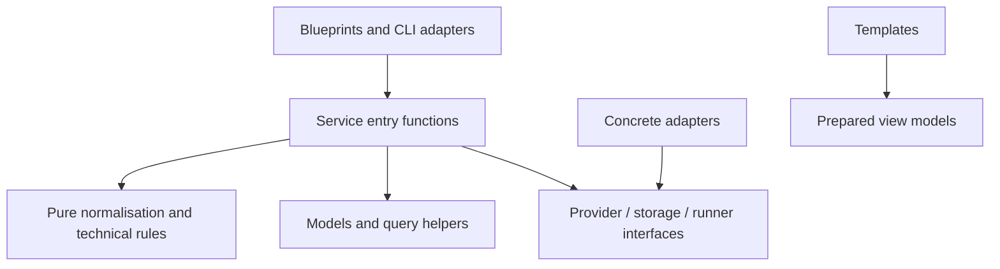

# Application architecture and coding boundaries

Owner: this document defines the application/module and HTTP contracts. Read [the overview](../architecture.md) and [access control](access-control.md) first. All paths below are proposed repository paths, not implemented files.

## 1. Runtime and dependency direction

One Python application package supplies web and trusted coordinator processes. Target execution and offline PDF rendering are restricted execution entry points, not independent business microservices. Start with synchronous Flask and bounded synchronous workers; do not introduce an async framework just for provider calls.

Routes parse HTTP and call one use case. Services own business policy and transaction boundaries. Query helpers own persistence expressions. Pure rules consume typed observations without Flask, network or ORM calls. Templates consume presentation models with no database access or permission decisions.

## 2. Module map

| Path | Owns | Must not do |
|---|---|---|
| `app/__init__.py`, `app/config.py` | Factory, validated startup settings and wiring | Start jobs, migrate schema or contact assessment targets |
| `app/extensions.py` | Unbound Flask extensions | Store per-user, per-case or provider-quota mutable state |
| `app/blueprints/auth/` | Flask-Security integration and team onboarding UI | Reimplement password/session primitives |
| `app/blueprints/assessments/` | Case/run/host views and forms | Implement discovery or issue verdicts |
| `app/blueprints/reports/`, `sharing/`, `admin/` | Authorised report/grant/configuration HTTP adapters | Infer access from a UUID or global admin role |
| `app/models/` | Typed ORM entities, constraints and named queries | Commit independently, fetch network data or import Blueprints |
| `app/service/access/` | Actor context, permissions and grant transitions | Trust actor IDs supplied by forms |
| `app/service/assessment/` | Scope and scan lifecycle | Invoke external endpoints inside a DB transaction |
| `app/service/discovery/` | CT paging, hostname normalisation and inventory | Treat wildcards as concrete hosts |
| `app/service/checks/` | Provider adapters, schemas and pure interpretation rules | Decide report sharing or supplier acceptance |
| `app/service/jobs/` | Durable scheduling, leases and quota accounting | Run in a Flask request or rely on in-memory correctness |
| `app/service/evidence/` | Artifact state, storage interface and retention | Expose filesystem paths or bucket keys to users |
| `app/service/reporting/` | Frozen snapshots, rendering orchestration and handoff metadata | Query live results during rendering |
| `app/templates/`, `app/static/`, `app/translations/` | Local UI assets, presentation, message catalogs | Embed provider secrets, raw collected HTML or domain decisions |
| `app/utils/` | Small generic helpers | Become the home of domain policy |
| `runner/` | Fixed collectors, sandbox transport and offline renderer entry points | Import credential-bearing application configuration |

Create packages when the implementation needs them; the map is not a request to pre-create empty abstractions. Use explicit constructor/function arguments for adapters, clock and configuration. No dependency-injection framework, universal repository base class, custom ORM or dynamic plugin loader.

## 3. Application composition

`create_app(test_config=None)` loads and validates configuration, initialises unbound extensions, registers Blueprints/CLI handlers/error handlers and configures security headers. Inject service dependencies through an app-owned container with a small explicit structure; extension objects may be module-level, but request-specific state cannot be. Flask documents this unbound-extension/factory approach. [Flask factories](https://flask.palletsprojects.com/en/stable/patterns/appfactories/).

Select exact compatible versions during initial implementation and record them in lockfiles. Expected dependency purposes: Flask; Flask-Security-Too and CSRF/forms integration; SQLAlchemy with a PostgreSQL driver and Alembic; an HTTP client; DNS/IDNA/public-suffix support; Playwright; a maintained message-catalog integration; test/static-analysis tools. Add an S3 SDK only when implementing that backend. Reuse Playwright for isolated print-to-PDF if it meets rendered-report requirements; do not add a second PDF engine without a concrete benefit.

Use one active SQLAlchemy session per request/use case or job transaction, never across worker threads/processes. Authentication may already have opened a transaction: compose the use case with that request session deliberately, and avoid blindly nesting `session.begin()` after queries. Do not use teardown to commit writes. On any failure roll back and dispose of the session. SQLAlchemy treats sessions as mutable transactional state, not a global concurrent cache. [Session basics](https://docs.sqlalchemy.org/en/20/orm/session_basics.html).

## 4. Service entry contracts

Commands are typed immutable inputs; actor context is built by the authenticated adapter, never deserialised from a user payload. UUIDs identify objects, aware UTC timestamps identify instants. Services return small result/view objects rather than request/session-bound ORM graphs.

| Entry point | Input and preconditions | Atomic effect/result |
|---|---|---|
| `create_assessment` | Actor, supplier label, canonical scope, optional purpose; active member | Insert case, owner grant and audit event together; return case ID |
| `start_scan` | Actor, case ID, request key, collection profile | Authorise; snapshot scope/config; insert run and discovery job in one transaction |
| `cancel_scan` | Actor, run ID, expected revision | Mark cancellation request and audit; coordinator stops new work and fences outputs |
| `annotate_finding` | Actor, finding ID, text/disposition, expected revision | Append revision; preserve original facts; reject lost-update conflict |
| `set_assessment_grant` | Owner, case ID, existing member, role/expiry | Validate permission ceiling and owner invariant; apply and audit atomically |
| `prepare_report` | Actor, terminal run ID, optional annotation selection, locales | Freeze snapshot and retention/evidence requirements; enqueue preparation |
| `approve_report` | Reviewer, draft version ID and snapshot hash | Bind approval to content/policy; reject self-approval when four-eyes enabled |
| `issue_report` | Owner, prepared version ID, expected revision | Validate rights/approval; enqueue or publish completed renderings under the lifecycle contract |
| `set_report_grant` | Owner, exact issued version ID, member and download flag | Grant only that version, audit and return share state |
| `record_tprm_handoff` | Owner/analyst with report access, version ID, human confirmation, record reference | Save actor/time/reference; never infer from download |

Every write affecting authorisation or issued evidence includes an audit row in the same transaction. No email, provider request or file upload occurs while holding that transaction. The durable job row is the initial transactional handoff; no extra event bus/outbox framework is needed. Notification email, if later enabled, is a separate explicitly defined job.

Idempotency keys are scoped to actor + resource + command and bound to a canonical input digest. A retry with the same digest returns the original result; reuse with different input returns conflict. Database uniqueness handles races. A new scan after a terminal run requires a new key. Use optimistic `revision` checks for human edits, and short row locks only for competing state transitions.

## 5. HTTP/UI contract

URLs are internal server-rendered routes, not a promised public REST API. Authentication/CSRF behaviour also applies to HTMX. UUID path variables always resolve through a scoped query.

| Method/path | Permission | Response |
|---|---|---|
| `GET /assessments` | Active team membership | Accessible cases only, paginated; no hidden-case counts |
| `POST /assessments` | Active member | Validated creation; redirect to case |
| `GET /assessments/<id>` | `assessment.read` | Technical summary |
| `GET /assessments/<id>/hosts` | `assessment.read` | Filtered host table/full page or partial |
| `GET /assessments/<id>/hosts/<host_id>` | `assessment.read` | Scoped host detail, observations and failures |
| `POST /assessments/<id>/runs` | `scan.start` | Enqueued run; progress URL |
| `GET /runs/<id>/progress` | `assessment.read` | Counts/status partial, no raw provider response |
| `POST /runs/<id>/cancel` | `scan.cancel` | Cancellation-request state |
| `POST /findings/<id>/annotations` | `finding.annotate` | Updated technical annotation partial |
| `POST /reports` | `report.prepare` on source case | Draft/frozen version and preparation state |
| `POST /reports/<version_id>/approve` | `report.approve` | Approval state bound to snapshot |
| `POST /reports/<version_id>/issue` | `report.issue` | Publication job/status |
| `GET /reports/<version_id>` | Effective version read | Preview from frozen content only |
| `GET /reports/<version_id>/download/<locale>` | Effective version download | Private authorised artifact stream |
| `GET /reports/<version_id>/evidence/<artifact_id>` | Effective version read/download as appropriate | Only frozen report-owned derivative |
| `GET /artifacts/<id>` | Source case evidence permission | Authorised source artifact; never unlocked by report-only grant |
| `POST /assessments/<id>/grants` | `assessment.share` | Grant result |
| `POST /reports/<version_id>/grants` | `report.share` | Exact-version grant result |
| `POST /reports/<version_id>/handoff` | `report.handoff` | Manual TPRM confirmation |

Add a CSRF-protected grant-revocation route within each scope when implementing sharing. No GET mutation, arbitrary URL fetch or arbitrary filesystem endpoint. Prefer POST/redirect/GET with 303 for full-page forms; HTMX can return an updated partial or explicit redirect. Enqueue responses may use 202 where the client handles it. Do not return an entire login page into a small expired-session fragment; redirect the browser to login.

Use 422 for field validation, 404 for nonexistent or inaccessible object IDs, 403 for denied action on an otherwise visible object, 409 for stale revision/idempotency conflict, 429 for application limits and 503 for an unavailable required internal dependency. HTML is the normal representation. A small internal JSON error envelope, when needed, contains `code`, translated `message`, optional field errors and correlation ID; never a traceback or upstream body.

Filters and sorting use allowlisted fields; default 50 rows/page, cap 100, stable order plus ID tie-breaker. Use keyset pagination for growing observation/event lists. HTMX polls only active runs, pauses in hidden tabs and backs off; server results are authoritative. Honour CSRF, same-origin requests and restrictive content policy. HTMX documents security concerns around injected content and request destinations; collected text must remain escaped ordinary text. [HTMX security](https://htmx.org/docs/#security).

## 6. Coding/design rules

- Prefer named domain functions over generic managers. A helper should have one reason to change.
- Distinguish parsing, normalisation, collection, interpretation and presentation; no function should do all five.
- Use `dataclass(frozen=True)` or an established schema type for values; use `Protocol` only at real I/O replacement boundaries. Do not abstract trivial string formatting.
- Model expected errors explicitly: validation, forbidden scope, stale revision, provider unavailable/quota, unsupported result schema and storage failure. Map them at the HTTP/job boundary.
- Preserve exception causes in internal errors but log only safe identifiers. Never catch an exception and return an empty successful result.
- Use bounded queries with explicit eager loading for a page; do not serialize lazy ORM relationships in Jinja. Add indexes from actual access patterns.
- Pure transformations receive an explicit clock/reference time when needed. No random values or `now()` calls buried inside interpretation rules.
- No executable user templates, shell interpolation, `eval`, unsafe YAML/pickle or import-time network work. Invoke necessary fixed tools with argument arrays and ceilings, not shell strings.
- Tests verify observable behaviour and trust boundaries. Comments explain reasons and invariants, not the syntax already visible in the code.

See [contribute.md](../contribute.md) for the implementation workflow and [implementation-plan.md](implementation-plan.md) for delivery gates.
