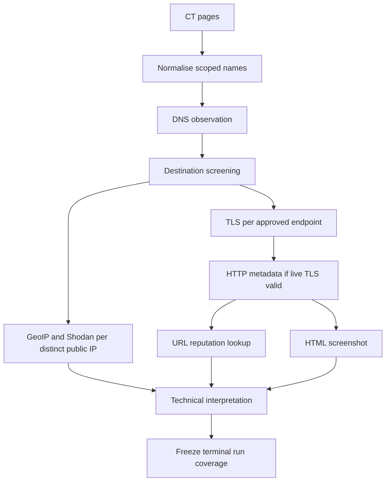

# Collection, provider adapters and durable jobs

Owner: execution contracts from domain input to terminal technical results. [Data model](data-model.md) defines persisted states; [access control](access-control.md) defines job authority. All numeric limits below are proposed configurable defaults, not verified capacity.

## 1. Scope normalisation

Accept one DNS name, trim whitespace, remove one terminal dot, normalise IDNA to ASCII and lowercase the canonical form. Preserve the original human-readable form for display with escaping. Validate label/total lengths and allowed DNS hostname syntax. Reject URL syntax, userinfo, paths, ports, IP literals, wildcard input, empty labels and public suffixes using a maintained, locally available public-suffix dataset. Do not fetch a suffix list during every request. Record the normaliser/dataset version with the scope snapshot.

Membership is exact equality or a dot-label descendant of the entered root. `notexample.com` is outside `example.com`; `example.com.attacker.test` is outside too. Do not automatically widen a subdomain scope. Discovery can record out-of-scope certificate SANs as excluded metadata but cannot schedule them. Wildcard certificate names are retained as patterns; they are not DNS enumeration instructions. An input apex can be probed even if CT discovery is empty, labelled `user_supplied`.

## 2. Job graph



Persist discovered hosts and subsequent jobs incrementally; do not wait for a large CT response set in memory. Each CT page commits normalised observations, the next cursor and next jobs atomically, so resumption neither loses a page nor schedules duplicates. A page budget hit makes discovery partial. Keep finite maximum run age so abandoned quota waits eventually terminate as partial; a later assessment is a new run.

DNS/TLS failures remain terminal observations. Passive per-IP enrichment can still run if a safe public IP was resolved; screenshot/HTTPS metadata jobs are skipped with reasons. Check applicable endpoints individually. Geography/shodan per-IP results are shared only within the run's scope and linked to hosts, not reused as current results across unrelated assessments.

Interpretation runs after the relevant source checks are terminal. Finalisation verifies discovery is closed and no more jobs can be generated. It must not race a child job inserted by another completion transaction; use a run lock/revision and a persisted producer-closed marker. Record `complete/partial/failed/cancelled` as defined in the data contract.

## 3. Adapter contracts

Adapters expose explicit operations, such as `discover_page(scope, cursor)`, `lookup_ip(ip)` and `lookup_url(url)`. They return validated typed values or typed failure classes. Do not expose an arbitrary provider URL/request body interface to the UI. Use fixed approved provider base URLs, bounded redirects and credential redaction. Provider responses and schema changes are untrusted input.

The normalised result envelope contains:

| Field | Meaning |
|---|---|
| `schema_version`, `adapter_version` | Contract/parser identity |
| `logical_check_key` | Stable run-scoped deduplication key |
| `subject` | Typed hostname/endpoint/IP/URL plus provenance references |
| `status`, `reason_code`, `verdict` | Execution, explanation and technical result; separate dimensions |
| `observed_at`, `collected_at` | Source time where available and retrieval time |
| `provider`, `method`, `vantage` | Origin and collection method/location identifier |
| `confidence`, `attribution` | Our evidence assessment, independent of provider verification |
| `data` | Bounded check-specific schema |
| `evidence` | Staged artifact references with hashes/media types/rights policy |

Synthetic normalised result example, not a real observation:

```json
{
  "schema_version": 1,
  "adapter_version": "fixture-v1",
  "logical_check_key": "reputation:https://example.com/",
  "subject": {"kind": "url", "hostname": "example.com", "url": "https://example.com/"},
  "status": "succeeded",
  "reason_code": null,
  "verdict": "no_match",
  "observed_at": null,
  "collected_at": "2026-10-01T10:00:00Z",
  "provider": "synthetic",
  "method": "url_reputation_lookup",
  "vantage": "test-fixture",
  "confidence": "unknown",
  "attribution": "hostname_supported",
  "data": {"threat_types": [], "coverage": "queried_url_only"},
  "evidence": []
}
```

Keep raw source payload only when permitted and useful. The absence of retained raw payload is recorded with a rights/retention reason. A missing Shodan entitlement, 404 no record, 429 quota response and malformed response have distinct outcomes. Unknown fields may be ignored within a compatible schema; missing critical fields fail explicitly. Never convert all provider exceptions into `[]`.

## 4. Provider-specific behaviour

CT: follow the hostname endpoint's opaque cursors, use keyed usage/balance metadata and reconcile the shared credential limiter across all workers. Plan constraints and use rights are summarised in [the overview](../architecture.md); recheck them before enabling production accounts. No anonymous fallback on quota failure. [CT API](https://api.ctlogs.dev/).

Shodan: query IP-level host observations; preserve service transport/port, source timestamp and verification flag where present. An inferred CVE is a potential finding, not an exploit result. Attribute only through relevant hostname/SNI/certificate/service evidence, explicitly labelled analyst correction, or leave it `ip_only/shared_infrastructure`. Do not call scan-submission endpoints. [Host API](https://developer.shodan.io/api), [verification semantics](https://help.shodan.io/mastery/vulnerability-assessment).

Location: use a licensed local IP/ASN dataset with a recorded version. Country/ASN evidence is an estimate of an observed network endpoint, never stored customer-data proof. Keep conflicting sources instead of silently overwriting one with another.

Reputation: submit only scoped public URLs without credentials/fragments or sensitive query values. Normally query the root and allowed redirect destinations actually used; preserve the queried URL scope and identify any redaction that limits coverage. Respect provider cache expiry separately from allowed historical archival. Candidate provider and export rights remain OPEN-05; fixtures must not conceal a disabled production check. [Web Risk lookup](https://docs.cloud.google.com/web-risk/docs/lookup-api), [redistribution limitation](https://docs.cloud.google.com/web-risk/docs/overview).

DNS: A/AAAA/CNAME are needed for collection; NS/MX can enrich provider metadata within a bounded query budget. External mail/name-server targets are dependencies only, not new scan scope. Do not query arbitrary record types or brute-force names.

### Initial technical rule catalogue

The following is an implementation baseline, not a supplier risk policy. Rules emit structured facts and translatable explanations with evidence IDs. Thresholds and severity mapping are versioned; provider source severity is preserved separately from platform finding severity.

| Rule ID | Trigger and interpretation | Proposed platform severity |
|---|---|---|
| `TLS_VALIDATION_FAILED` | Live endpoint fails trust/name/time validation; retain exact reasons and stop dependent HTTPS collection | Medium; a verified transport-control failure, not proof of compromise |
| `TLS_EXPIRING_SOON` | Valid certificate expires within configured window, initially 30 days | Low operational warning; automatic renewal may make it non-actionable |
| `REPUTATION_MATCH` | Licensed provider reports queried URL on an applicable threat list | High, labelled provider-reported/suspected and time-bound, never independently verified malware |
| `SHODAN_CVE_OBSERVED` | Service banner contains CVE metadata | With supported hostname attribution, use supplied CVSS severity category where its version/score is known; otherwise informational plus original source severity, requiring validation |
| `SERVICE_EXPOSURE_OBSERVED` | Shodan reports a port/transport/service | Informational inventory by default; an open port is not inherently a vulnerability |
| `HTTP_SECURITY_SIGNAL_MISSING` | Selected header absent on the actually observed response | Informational signal with response context; no blanket conclusion about application security |
| `PROVIDER_DEPENDENCY_OBSERVED` | DNS/network/browser evidence suggests provider relationship | Informational, with method/confidence and no contractual processor claim |
| `COLLECTION_INCOMPLETE` | Quota, licence, timeout, budget or collection failure leaves an applicable check unknown | Coverage notice, not a supplier security severity |

No inferred CVE becomes a confirmed exploit finding. A provider verification flag, CVSS severity, attribution and evidence age remain distinct fields. Show actual timestamps and allow a configurable stale-evidence notice; do not silently refresh the timestamp to the retrieval time. Rules suppress duplicate findings for the same rule/subject/source issue, while retaining all supporting observations. Technical summary generators consume these facts and limitations, not free-form risk judgements.

## 5. Target-runner protocol and security boundary

The trusted coordinator sends a versioned job to a runner supervisor over an authenticated internal channel. The supervisor holds transport identity; the disposable target process receives no reusable credential. Job input includes job ID, lease generation, deadline, canonical hostname, approved collection profile, destination policy version, bounded approved endpoint set and resource limits. It excludes DB credentials, provider keys, object-store keys and application session cookies.

A fixed collector command processes the job in an isolated environment. Results return through a bounded local pipe/spool to the supervisor; no caller-selected upload URL or unrestricted callback. The coordinator authenticates the supervisor, verifies job/generation/schema/byte counts and recomputes hashes before persistence. Treat runner output as untrusted even when the transport is authenticated. Stale or cancelled job output is discarded and staging cleaned.

Network rules are mandatory before real target collection:

- Resolve through controlled DNS; reject private, loopback, link-local, multicast, reserved, metadata and deployment-internal destinations for both IPv4/IPv6. Include mapped IPv4, alternate textual forms and transitional routes in tests. Reject mixed safe/unsafe answer sets.
- Pin the approved destination per connection while preserving hostname/SNI and certificate validation. If DNS changes, perform fresh policy validation; never fall back to an unchecked resolver or raw IP URL with disabled TLS.
- A browser root navigation must match the endpoint approved by its TLS check; record any new connected address and validate it again. Do not claim the screenshot represents a different IP previously probed.
- Route browser traffic through controlled egress that validates DNS and destinations for every request/redirect/subresource; block direct network bypass, QUIC, WebRTC and unnecessary protocols. Application request interception alone is not the network boundary.
- Top-level navigation remains in scope. Out-of-scope redirects stop with a visible reason. Public third-party assets can load through egress for rendering, but are recorded as dependencies and are not recursively assessed. Deny non-HTTP(S) schemes and unapproved destination ports.
- Keep Chromium sandbox enabled, run non-root with restricted capabilities/filesystem and a disposable profile, no host mounts/Docker socket and no access to trusted service networks. Restrict CPU/memory/process count and wall time. Do not use `--no-sandbox` for convenience.

Allowed target ports are HTTPS 443 and, when explicitly enabled in the collection profile, HTTP 80 for a bounded redirect/header observation. Other open ports come from Shodan, not direct connection sweeps. No forms, logins, consent acceptance, downloads or user interactions during screenshots. JS execution for normal page rendering is allowed in the sandbox. Block browser service workers and unnecessary background protocols where practical; record policy-induced rendering limitations.

TLS qualifies only with chain trust, name match and time validity. Revocation is separately reported as `not_checked/unknown/good/revoked`; do not downgrade verification after failure. A valid wildcard certificate can validate a concrete discovered hostname under standard hostname rules without revealing other names.

Screenshot contract: PNG, fixed proposed 1440×900 viewport, capture after bounded DOM readiness plus a short bounded settle period, not unlimited `networkidle`. Record final URL, connected endpoint, capture time, viewport, browser version, policy and blocked-resource counts. Default one viewport; full-page capture only with explicit pixel ceiling. If content is not HTML, mark `not_applicable`; a login page can be captured but no login is attempted. Offline reports use a separate renderer profile with no target-network access. [Playwright production isolation cautions](https://playwright.dev/python/docs/docker).

## 6. Durable queue algorithm

1. Claim a due job with `FOR UPDATE SKIP LOCKED`, increment generation, set lease/owner and commit immediately. Only an authenticated coordinator identity may claim. [PostgreSQL queue locking](https://www.postgresql.org/docs/current/sql-select.html).
2. Load the immutable job input and verify case/run state and initiating principal still has authority. Case/archive or access revocation prevents new target work; already collected evidence stays with the case. Owner can start a new run if needed.
3. Reserve provider quota under a short credential/period lock if needed. If insufficient, set `waiting_provider` plus next eligible time; do not hold a row lock while waiting.
4. Execute network/storage work outside DB transactions. Heartbeat the lease during long jobs. Deadlines and cancellation propagate to the supervisor.
5. Validate/stage output. In a new short transaction require matching job ID, current owner/generation and uncancelled run; persist logical result, evidence metadata and child jobs, then mark success.
6. Reconcile spent/unknown quota reservations. If a crash leaves whether a call was billed unknown, reconcile with provider balance; do not blindly refund and overspend.
7. On failure classify it: transient retry, quota wait, terminal invalid input, entitlement/configuration failure or blocked target. Back off with jitter; after attempt/run deadlines preserve explicit partial coverage.

Exactly-once external calls are not promised. A crash after a provider response but before commit may repeat the paid call. Exactly one accepted logical result is enforced by uniqueness plus generation fencing. A reclaimed worker cannot later overwrite the new generation. Repeated enqueue uses the same logical key; intentional recheck uses a new run. Never keep a whole workflow in Python memory.

Cancellation first writes intent and prevents scheduling. Kill sandbox work after a bounded grace period; reject later output under the run-state/generation check. A waiting-provider run is not terminal until resumed, cancelled or maximum run age expires. Terminal runs are immutable; a partial run can be reported with limitations or replaced by a new run.

## 7. Proposed resource defaults

| Limit | Initial value | At limit |
|---|---|---|
| Concrete hosts/run | 1,000 | Stop scheduling additional hosts, mark discovery/coverage partial |
| IP endpoints/host | 16 | Record untested count and partial endpoint coverage |
| Network jobs/domain | 4 | Queue remaining jobs |
| Screenshot jobs/runner | 2 | Queue; never increase without memory testing |
| Connect / total request time | 5 / 15 seconds | Typed timeout; bounded retry |
| Screenshot wall time | 30 seconds | Failed/partial capture reason |
| Redirect hops | 5 | Stop, record chain and limit |
| HTTP/provider response bytes | 2 MiB / 5 MiB | Reject oversized response, no success-shaped truncation |
| Screenshot pixels / artifact size | 10 million / 20 MiB | Reject oversized capture |
| Run wall time | 24 hours | Terminal partial/failed with quota/deadline reason |
| Lease / heartbeat | 120 / 20 seconds | Reclaim expired lease with new generation |
| Transient attempts | 3 | Terminal failed check; no tight loop |

All byte limits apply after decompression too. Use global and per-workspace budgets in addition to per-domain concurrency. Configuration can reduce caps; provider limits always win. Production network controls cannot be disabled by an assessment form. Test fixtures use a separately isolated test runner/profile; a production `allow_private_targets` switch is not part of the design.
