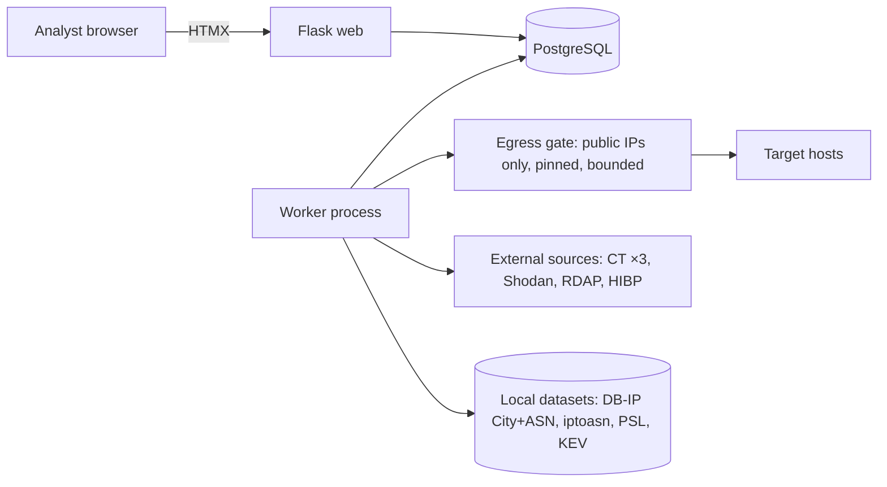

# MVP restart — design

> 2026-10-04 · **Status: approved 2026-10-04 — implementation started on branch `mvp`.** Confirmed by the owner: D2 (Apache-2.0), D3/D4 (lean access defaults), D9 (24 months), D10 (CDN → Medium, low confidence), baseline snapshot (`baseline-1`). The change list (city, Shodan key, three CT sources, breach and location rules, finding acceptance) is folded into the roadmap, catalogue and plan. · Supersedes `docs/architecture.md`, `docs/design/*`, `docs/implementation/*`, `docs/backlog.md` (archived by S0.1)
> Companions: [roadmap](../../roadmap.md) (epics/stories) · [checks catalogue](../../checks-catalog.md) · [improvement plan](../../archive/2026-10-baseline-1/improvement-plan.md) (code review, archived)

## 1. Understanding

**You said**
- Help security teams do the *technical* side of vendor due diligence from a single pane of glass. Input is a domain; every host found via Certificate Transparency gets a technical review. Today this is done by hand with web-check.xyz.
- 1–5 users now, open source later. Follow security best practice, not military grade.
- The earlier attempt (another coding agent) was stopped: too complicated, too expensive. You want early results as an MVP, with web-check as inspiration and free inputs where possible.
- PostgreSQL is configured in `.env` (WSL, PG 17). GeoIP was switched from a MaxMind DB to an API on purpose.

**Changes you requested (2026-10-04)**
- C04 includes the **city** (DB-IP City Lite; you pointed to the `wp-statistics/DbIP-City-lite` mirror).
- You have a Shodan API key → the Shodan host API is the primary ports/CVE source; InternetDB (which needs no key) is the keyless fallback.
- CT discovery from three sources: ctlogs.dev, CertSpotter and crt.sh.
- `PUBLIC_BREACH_HISTORY`: Medium, High for a recent breach. New `LOCATION_OUTSIDE_EU_CH`: High for systems hosted outside the GDPR area.
- A "finding accepted" status.

**I assumed — please correct**
- A1. The old three questions stay the organising idea: *Where is the data? Who processes it? How secure is the external posture?*
- A2. "Review" means non-intrusive collection only: DNS, one TLS handshake, one HTTP GET, public datasets. No port scanning, no exploitation, no logins.
- A3. Free, keyless sources first; keyed or paid ones are optional adapters.
- A4. English UI and report for the MVP; de-CH comes later (strings stay translatable).
- A5. Internal deployment behind a TLS reverse proxy; not a public service.
- A6. "Shodan InternetDB — I have an API key": InternetDB itself takes no key, so I read this as *your Shodan API key* and use the full host API with it (decision D5/S2.2).

## 2. Why restart (details in the [improvement plan](../../archive/2026-10-baseline-1/improvement-plan.md))

- The live UI cannot render, and the tests cannot run on the configured Postgres.
- The schema and plan serve a multi-tenant product: 22 tables, 16 with `workspace_id`, RLS helper functions, grants, lease-fencing queue, immutable hashed reports, retention clocks.
- First user-visible value sat at milestone M5 of M7; the docs total ≈ 514 KB.
- Worth keeping: the SSRF gate, TLS prober, scope normaliser, factory/config pattern, the "typed outcome" discipline.

## 3. Approaches considered

| | Refactor in place | **Selective rebuild** | Greenfield |
|---|---|---|---|
| Idea | Peel layers off the existing schema and keep 167 tests green | New lean schema, engine and UI in this repo; port the proven leaf modules with their tests | Start empty |
| First demo | Late | **Early** | Early |
| Risk | Everything depends on `workspace_id`/RLS/jobs | Low if ported modules keep their tests | Re-introduces SSRF/TLS bugs |

**Recommendation: selective rebuild.**

## 4. Target design (MVP)

### 4.1 Shape



One codebase, two processes: `flask run` (web) and `flask worker`. No broker, no hidden threads at import time.

### 4.2 Data model

```
assessment(id, domain, label, visibility, created_by, created_at)
scan(id, assessment_id, status, options, started_at, finished_at, summary)
host(id, scan_id, hostname, source, first_seen, last_seen)                    unique(scan_id, hostname)
check_result(id, scan_id, host_id?, check_key, status, reason_code, data jsonb,
             source, collected_at, duration_ms, locked_by, locked_at)         unique(scan_id, host_id, check_key)
finding(id, scan_id, host_id?, rule_id, severity, confidence, params jsonb,
        fingerprint)                                                          unique(scan_id, fingerprint)
finding_disposition(id, assessment_id, fingerprint, status, reason, decided_by,
                    decided_at, review_by?)                                   unique(assessment_id, fingerprint)
provider_cache(provider, key, fetched_at, payload jsonb)                      primary key(provider, key)
user / role / user_roles / auth_rate_limit_bucket                             Flask-Security-Too
```

`check_result` is also the work queue: a row in status `queued` is a task. Statuses: `queued | running | ok | no_data | unavailable | error | skipped`. A re-scan creates a new `scan`, so history comes for free. Scan states: `queued → running → completed | partial | failed | cancelled`.

**Finding acceptance.** `fingerprint` is a hash of the rule ID and the subject (host, IP or domain). A finding's effective status is the disposition stored for its fingerprint — `accepted` or `false_positive` (an accepted finding reverts to open once `review_by` has passed) — otherwise `open`. Dispositions belong to the *assessment*, so they survive re-scans, and the evidence itself is never changed. Every change records author and time (and enters the audit log from S3.5). **`provider_cache`** holds per-IP and per-domain provider answers (Shodan, RDAP, HIBP, KEV…) with a TTL so re-scans do not repeat rate-limited or paid calls.

### 4.3 Checks, rules, summary

A check is one module with a typed contract ([catalogue §6](../../checks-catalog.md#6-how-to-add-a-check)). Rules turn outcomes into findings with stable IDs ([catalogue §4](../../checks-catalog.md#4-initial-rule-set)). The summary cards are computed from `check_result` and `finding`, never from free text:

- **Where** — countries, cities and ASNs of resolved IPs; hosts outside the allowed area (EU-27 + EEA + CH) highlighted; CDN/anycast flagged as "edge, not data location".
- **Who** — providers grouped by hosting/CDN (ASN), DNS (NS), email (MX + SPF includes), later third-party requests.
- **Secure** — open findings by severity (accepted ones shown separately), top findings, coverage ("112 of 148 hosts fully checked"), and the caveat that this is not a certification.

### 4.4 Execution

1. Discovery task inserts hosts (capped, default 200) and queues one row per (host, check) plus the domain-level checks.
2. The worker claims rows with `FOR UPDATE SKIP LOCKED`, runs them in a thread pool (default 8), per-target concurrency 4, one rate limiter per external provider, timeouts everywhere.
3. A check whose `needs` are not `ok` becomes `skipped` with a reason.
4. When all rows are terminal, rules run and the summary is stored.
5. Crash safety: rows locked longer than 10 minutes are re-queued; the unique key makes retries idempotent. No leases, generations or quota ledger.

### 4.5 Security baseline (kept deliberately small)

- All target-facing traffic goes through the egress gate (public IPs only, IP-pinned with SNI, redirect hops re-screened, ports 80/443, byte/time caps, no credentials sent).
- Domain input validated with the real Public Suffix List; host and scan caps; per-user scan rate limit; a configurable blocklist of domains.
- Flask-Security-Too (argon2), CSRF on every mutating form/HTMX call, secure cookies, CSP without inline scripts, login rate limit, optional TOTP MFA.
- Secrets only from the environment; `.env` stays ignored; startup fails fast on weak production secrets.
- Output escaped; collected HTML is never rendered.
- Not in the MVP: RLS, per-report grants, signed/hashed report snapshots, retention clocks, SSO.

### 4.6 UI

Server-rendered Jinja + HTMX + Tailwind (existing tokens). Pages: login · assessments list/new · assessment (progress, summary cards, tabs *Hosts / Findings / Domain / Export*) · host drawer · scan history. English first; all strings go through `_()`.

### 4.7 Configuration

Environment variables only.
- **Core:** `DATABASE_URL`, `DB_SCHEMA`, secrets, `MAX_HOSTS_PER_RUN` (existing name, default lowered to 200), `WORKER_THREADS`, `BLOCKED_DOMAINS`, `REQUIRE_MFA`.
- **Sources:** `CT_SOURCES`, `CT_MODE`, `CTLOGS_API_KEY`, `CERTSPOTTER_TOKEN`, `PORTS_PROVIDER`, `SHODAN_API_KEY`, `GEOIP_PROVIDER`, `GEOIP_DATA_DIR`.
- **Policy:** `DATA_LOCATION_ALLOWED`, `BREACH_RECENT_MONTHS`.

## 5. Scope

| In the MVP | Not in the MVP |
|---|---|
| Domain → CT hosts (3 sources) → DNS, TLS, HTTP, IP/ASN/**city**/country, ports/CVEs (Shodan key or InternetDB); email, RDAP, security.txt, breaches; location and breach rules; summary, findings with **acceptance**, JSON/CSV/HTML export; re-scan and diff; private/team visibility; docker compose | Screenshots, third-party request map, TLS cipher scan, takeover, reputation (R4); PDF/de-CH, SSO, retention, monitoring, TPRM API (R5) |

## 6. Decisions needed (defaults apply if you do not object)

| # | Decision | Default |
|---|---|---|
| D1 | Selective rebuild instead of refactor or greenfield | **Selective rebuild** |
| D2 | Project licence | **Apache-2.0** — *confirmed 2026-10-04* (keeps AGPL/GPL tools and data out of the core). Alternative was AGPL-3.0, which would allow bundling sslyze and webappanalyzer data |
| D3 | MFA | **Optional by config**, on by default in production — *confirmed 2026-10-04* (old design: always mandatory) |
| D4 | Visibility | **Private by default** with a "share with team" toggle; admins can see everything — *confirmed 2026-10-04* (small-team simplification) |
| D5 | External lookups | **Free sources plus your keys** (Shodan; ctlogs.dev / CertSpotter if you have them), each switchable; an offline-only mode can follow if M&A confidentiality requires it |
| D6 | Reports in the MVP | **HTML / JSON / CSV**; PDF and de-CH after the MVP |
| D7 | Host cap per scan | **200** (maximum 1000) |
| D8 | GeoIP | **DB-IP City + ASN Lite offline** (city, region, country); official download first, `wp-statistics` mirror as automatic fallback, API fallback by config |
| D9 | What is a "recent" breach | **≤ 24 months** (`BREACH_RECENT_MONTHS`) → `PUBLIC_BREACH_HISTORY` is High, otherwise Medium — *confirmed 2026-10-04* |
| D10 | Location rule severity | **High** when a non-CDN host has an IP outside the allowed area; **Medium with low confidence for CDN/anycast** IPs (edge only) — otherwise every CDN-fronted vendor would be High — *confirmed 2026-10-04* |
| D11 | Allowed area for D10 | **EU-27 + EEA (IS, LI, NO) + CH**, configurable (`DATA_LOCATION_ALLOWED`) |
| D12 | CT sources | **Union** of ctlogs.dev, CertSpotter and crt.sh (`CT_MODE=union`); `first` saves quota |
| D13 | Finding acceptance | **Any user who can edit the assessment** may accept; reason required; optional review-by date (then it expires); carries over to re-scans; listed in the report |

D9–D13 are my reading of your change list — please correct any that is off.

## 7. Risks

- **crt.sh is unreliable** → three CT sources merged, retry/backoff, manual hosts.
- **Free-API terms change** (InternetDB, ip-api, free ctlogs.dev keys are non-commercial) → provider interfaces, `unavailable` status, switches.
- **Shodan adapter CVE parsing is unverified** against a real response → fixtures recorded from your key in S2.2 (with your OK).
- **City accuracy for server IPs is poor** → shown for context, never used by rules.
- **Scanning third-party infrastructure** → low-impact requests only, identifying User-Agent, blocklist, usage notice.
- **Auth flow untested end-to-end** → manual login test in S0.4.
- **Estimates are guesses** until R0/R1 produce real throughput.
